# PGIXS Python 데스크탑 앱 사용자 매뉴얼

PGIXS는 **MATLAB 버전**과 **Python 버전** 두 가지로 제공된다. 이 문서는 그중
Python 버전(PySide6 데스크탑 GUI)의 상세 사용자 매뉴얼이다. MATLAB 버전과 기능이
동등하며, MATLAB 라이선스 없이 Windows/macOS/Linux 어디서나 실행할 수 있다. 앱은
**SDD Calibration / GIXS / GIXS-series / TrXS / TrXS-series / XTrans /
Penetration Depth** 7개 탭으로 구성된다.

> 설치/다운로드 방법은 리포지토리 루트의 `README.md`를 참고한다 (Windows/macOS/Linux
> 실행 파일을 Releases 페이지에서 받거나, 소스에서 `python -m pgixs_python.desktop.app`로
> 직접 실행할 수 있다).

---

## 목차

1. [전체 구조와 사용 순서](#1-전체-구조와-사용-순서)
2. [SDD Calibration 탭](#2-sdd-calibration-탭)
3. [GIXS / TrXS 탭 (공통 콘솔)](#3-gixs--trxs-탭-공통-콘솔)
4. [GIXS-series 탭](#4-gixs-series-탭)
5. [TrXS-series 탭](#5-trxs-series-탭)
6. [XTrans 탭](#6-xtrans-탭)
7. [Penetration Depth 탭](#7-penetration-depth-탭)
8. [공통 개념 정리](#8-공통-개념-정리)
9. [문제 해결](#9-문제-해결)

---

## 1. 전체 구조와 사용 순서

프로그램 상단 탭은 다음 순서로 배치돼 있다.

| 순서 | 탭 이름 | 용도 |
| --- | --- | --- |
| 1 | **SDD Calibration** | 캘리브런트(예: Silver behenate) 링 패턴으로 sample-to-detector distance(SDD)를 구하는 독립 도구. 실제 실험에서 GIXS/TrXS 분석보다 먼저 해야 하는 작업이라 맨 앞에 있다. |
| 2 | **GIXS** | 단일 프레임 grazing-incidence 데이터 처리 콘솔. |
| 3 | **GIXS-series** | GIXS의 시리즈(시간/온도/각도 스캔) 버전 — 프레임 여러 장을 한 번에 불러와 프레임별 커브를 계산. |
| 4 | **TrXS** | 단일 프레임 transmission 데이터 처리 콘솔. |
| 5 | **TrXS-series** | TrXS의 시리즈 버전. |
| 6 | **XTrans** | 화학식 기반 X-ray 투과율/임계각/SLD 계산기 (검출기 이미지와 무관한 독립 계산기). |
| 7 | **Penetration Depth** | 특정 입사각 범위에서의 X-ray 침투 깊이 계산기 (역시 독립 계산기). |

**일반적인 실험 순서**는 다음과 같다.

1. **SDD Calibration**에서 캘리브런트 이미지를 불러와 SDD를 구하고 캘리브레이션 파일(JSON, `.mat`/`.std` 동반 파일)을 저장한다.
2. **GIXS** 또는 **TrXS**(단일 프레임을 빠르게 확인할 때) / **GIXS-series** 또는 **TrXS-series**(여러 프레임을 한 번에 처리할 때)에서 데이터를 불러오고, 위에서 저장한 캘리브레이션 파일을 **Load Info**로 불러온다.
3. 필요하면 Grid Remove, Background subtraction/Normalization을 적용한다.
4. **q-Cal / q-Map Cal.**로 pixel → Q 변환을 계산한다.
5. Line/Cakecut/Accumulation/Circular Average/Azimuthal Process/ROI 등으로 1D 커브를 뽑고 저장한다.
6. 필요하면 **XTrans**/**Penetration Depth**에서 시료의 투과율·임계각·침투 깊이를 별도로 계산해 실험 조건(에너지, 두께, 입사각 범위)을 잡는 데 참고한다.

같은 `ConsoleWidget` 클래스를 GIXS/TrXS가 공유하고, GIXS-series/TrXS-series도 구조가
비슷하므로, 아래 3장/4장/5장은 "공통 설명 + 모드별 차이" 형태로 정리했다.

GIXS 탭이나 TrXS 탭에서 파일을 불러오는 동안에는(백그라운드 로딩 중) 다른 탭으로
전환할 수 없다 — 두 콘솔이 내부적으로 같은 세션 슬롯을 공유하기 때문에, 로딩 도중
전환하면 데이터가 꼬일 수 있어서 막아둔 것이다.

---

## 2. SDD Calibration 탭

MATLAB 버전의 `SDDcal_gui.m`(+ `OneDplotpixel_gui.m`/`OneDplotpixelR_gui.m`)과
동일한 워크플로우를 따른다. 캘리브런트 링 이미지를 불러와서 빔 중심을 잡고, 방사형(radial) 또는 라인 프로파일을
뽑아 링 피크를 가우시안 피팅한 뒤 SDD를 계산하고, GIXS/TrXS의 **Load Info**가 읽는
캘리브레이션 파일을 저장하는 탭이다.

### 2.1 왼쪽 패널

**상단 (LOAD DATA)**

- **Directory** 입력창 + **Set** 버튼 — 폴더 선택 다이얼로그. 이후 LOAD IMAGE DATA가 여기서 시작한다.
- **Detector** 콤보 — `Eiger4M`, `MarCCD`, `MX170HS`, `PI-CCD`, `MAR345` 중 선택.
- **LOAD IMAGE DATA** 버튼 — 캘리브런트 이미지를 불러온다. 불러오면 Center [Y, Z]가 자동으로 채워지고, 범위/커브/피팅 상태가 초기화된다.

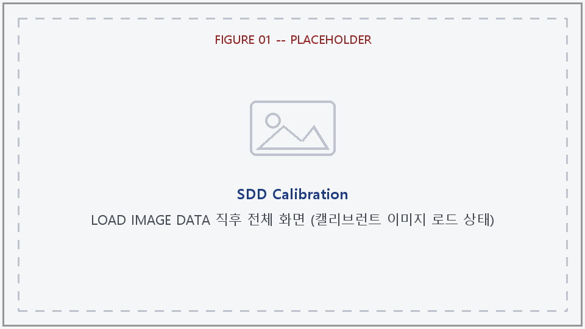

**Manual Calibration**

- **Center [Y, Z]** — 빔 중심 좌표 두 필드.
- **Set C** 버튼 — 2D 이미지를 클릭해서 그 위치를 중심으로 설정.

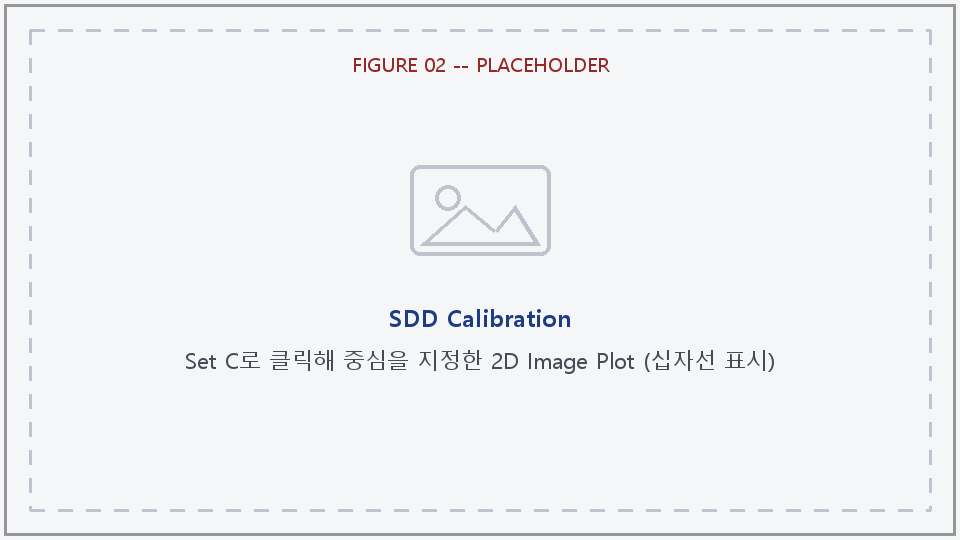

- **Update Center** 버튼 — 위 Center [Y, Z]에 직접 입력한 값을 그대로 적용.
- **Y_Plot (Fit)** / **Z_Plot (Fit)** — 현재 중심을 지나는 Y방향/Z방향 라인 프로파일을 뽑아 "1D Result" 패널에 그린다.
- **Rad.Ave (Fit)** — 중심 기준 방사형(azimuthal 평균) 프로파일을 뽑는다.

**Peak Fit**

- **Fit Mode** 콤보 — `Single Peak` / `Symmetric Peaks (+/-)`. Symmetric 모드는 Y_Plot/Z_Plot 라인 컷에만 적용되고 Rad.Ave에는 적용되지 않는다.
- **1. Select Data Range** 버튼 — 1D 커브 위에서 범위를 클릭으로 지정한다. Single 모드는 시작→끝 2번 클릭, Symmetric 모드는 왼쪽 피크 시작/끝 → 오른쪽 피크 시작/끝 총 4번 클릭한다.
- **2. Gaussian Fit Peak(s)** 버튼 — 선택한 범위에 가우시안 피팅을 실행하고, 피팅 커브를 커브 위에 겹쳐 그린다(Single은 빨강, Symmetric은 좌/우 각각 다른 색). 결과는 **Offset: -** 라벨에 표시되며(중심 위치, R², Symmetric은 반경까지), 방사형(radial) 커브였다면 **Pixel Radius**(아래 Calc SDD 섹션)도 자동으로 채워진다.
- **Offset: -** — 마지막 피팅 결과 표시 라벨.
- **Apply to Center** 버튼 — 방금 한 Y_Plot/Z_Plot 피팅 결과(offset)를 Center [Y, Z]에 반영한다.

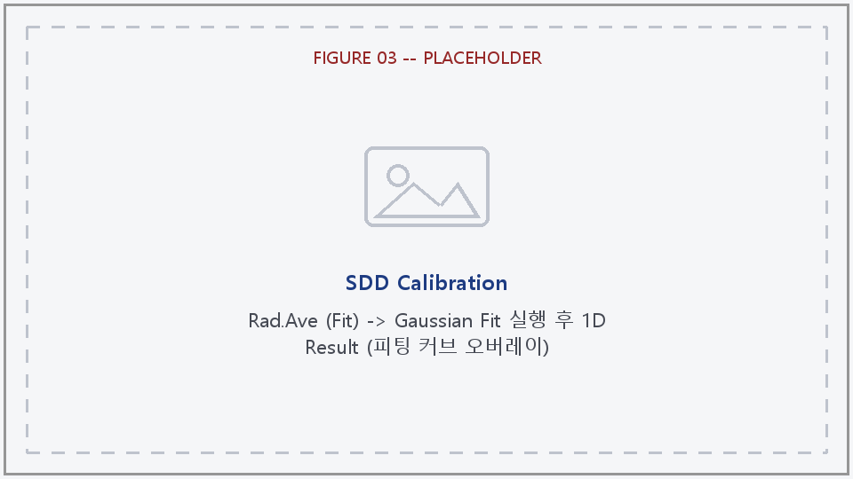

**Smart Auto Run**

- **SMART AUTO RUN** 버튼 — Center [Y, Z]가 대략 맞은 상태에서 누르면, 빔 중심을 자동으로 미세 조정하고, 캘리브레이션 링들을 자동으로 탐색해서 SDD까지 한 번에 계산해준다(로컬 refinement이므로 중심이 너무 많이 틀어져 있으면 먼저 Manual Calibration으로 대략 맞춰야 한다).
- 결과 **후보 테이블**(Candidate table) — 컬럼: **Radius, Order, Coverage, R2, SDD, Use**. 찾은 링 후보들과 각각 채택 여부("Yes"/"No")가 표시된다.

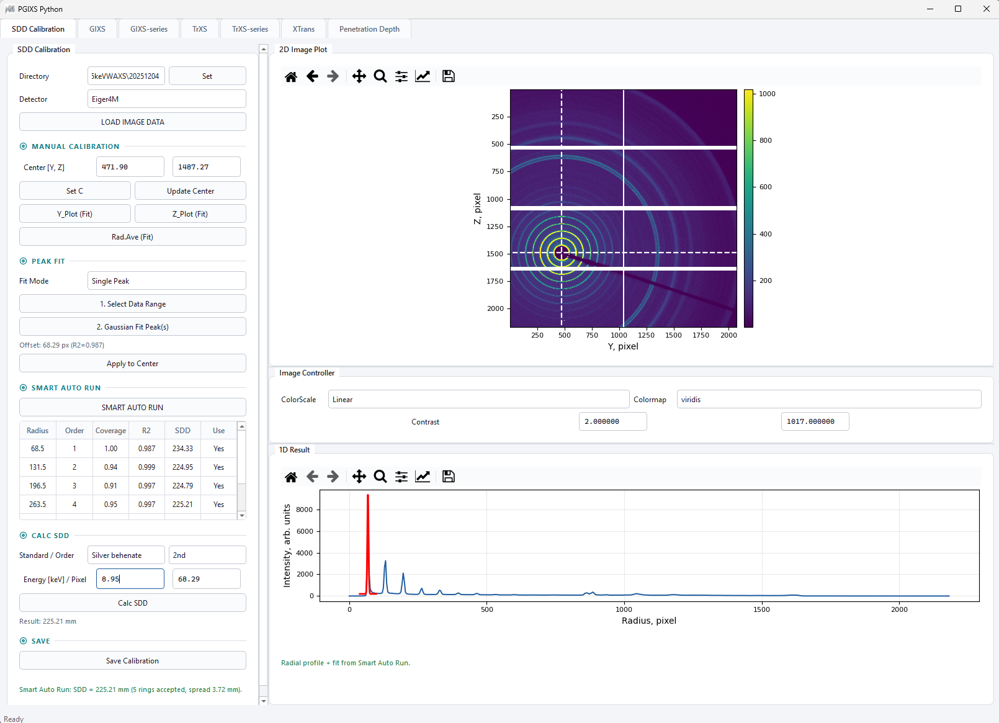

**Calc SDD** (수동 계산 / Smart Auto Run과 공유되는 입력값)

- **Standard / Order** — Standard 콤보: `SEBS`, `Silver behenate`(기본값), `Mesoporous Silica`, `Sucrose`. Order 콤보: `1st`~`7th` (몇 번째 회절 링인지).
- **Energy [keV] / Pixel** — 사용한 X-ray 에너지, 그리고 측정된 링의 픽셀 반경(Pixel Radius — 수동 입력하거나 피크 피팅/Smart Auto Run에서 자동으로 채워짐).
- **Calc SDD** 버튼 — Pixel Radius + Order + Standard + Energy로 SDD를 수동 계산한다. 결과는 **Result: - mm** 라벨에 표시.

**Save**

- **Save Calibration** 버튼 — 캘리브레이션 값을 JSON(+ `.mat`/`.std` 동반 파일)으로 저장한다. 이 파일을 GIXS/TrXS 탭의 **Load Info**가 읽는다.

### 2.2 오른쪽 패널

- **2D Image Plot** — 불러온 캘리브런트 이미지. "Set C"가 켜져 있으면 클릭해서 중심 설정. 현재 중심을 지나는 십자선(0°/90°)이 표시된다.
- **Image Controller** — ColorScale(`Linear`/`Log`), Colormap, Contrast(cmin/cmax, 소수점 6자리 — 작은 값도 0으로 뭉개지지 않도록). 모두 즉시 반영(별도 Update 버튼 없음).
- **1D Result** — Y_Plot/Z_Plot/Rad.Ave 결과 커브, 피팅 오버레이, 범위 선택 마커를 표시. 아래에 "Range: … to … px. Ready to fit." 같은 상태 텍스트가 뜬다.

### 2.3 작업 순서 정리

1. (선택) Directory 설정 → **LOAD IMAGE DATA**로 캘리브런트 이미지 불러오기.
2. **Set C** 클릭 또는 Center [Y, Z] 직접 입력 + **Update Center**로 중심을 대략 잡는다.
3. (선택, 더 정밀하게 잡고 싶으면) **Y_Plot (Fit)**/**Z_Plot (Fit)**/**Rad.Ave (Fit)** → **1. Select Data Range** → **2. Gaussian Fit Peak(s)** → **Apply to Center**.
4. **추천 경로**: 중심이 대략 맞았으면 **SMART AUTO RUN** 한 번으로 중심 미세조정 + 링 탐색 + SDD 계산까지 끝낸다.
   **수동 경로**: Rad.Ave (Fit)로 Pixel Radius를 구한 뒤, Standard/Order/Energy를 지정하고 **Calc SDD**.
5. **Save Calibration**으로 캘리브레이션 파일을 저장한다 (GIXS/TrXS의 Load Info에서 사용).

---

## 3. GIXS / TrXS 탭 (공통 콘솔)

GIXS 탭과 TrXS 탭은 내부적으로 완전히 같은 위젯(`ConsoleWidget`) 코드를 쓰고,
설정값(config)만 다르다. 아래 표로 두 모드의 차이를 먼저 정리한다.

| 항목 | GIXS | TrXS |
| --- | --- | --- |
| Detector 목록 | Eiger4M, MarCCD, MX170HS, PI-CCD, MAR345 | Eiger4M, MarCCD, MX170HS, PI_CCD |
| 입사각(Incidence) 캘리브레이션 섹션 | 있음 | 없음 |
| Footprint(FP) 입력 | 있음 | 없음 |
| Cakecut / Accumulation / Pos move | 있음 (1D Plot Process에서) | 없음 |
| Circular Process 섹션 | 없음 | 있음 (TrXS만의 1D 대표 처리 방식) |
| Map format | Pixel / Qxy/Qz / Qy/Qz | Pixel / Qy/Qz |
| Azimuthal Process 각도 스윕 범위 | 0~180° (grazing incidence는 수평선 위쪽만 산란) | 0~360° (전체 링) |

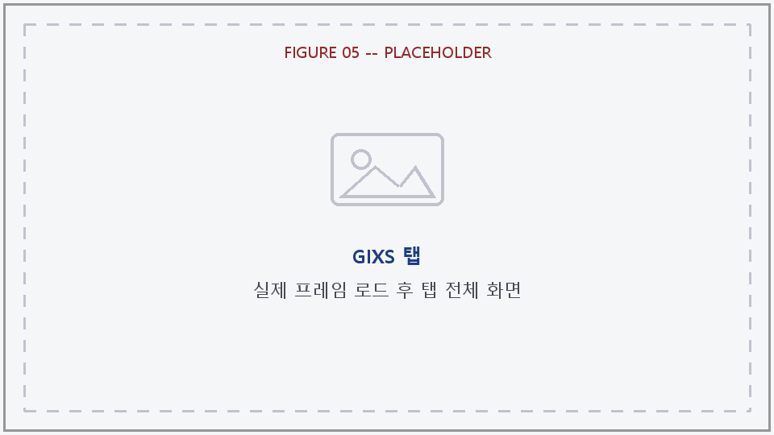

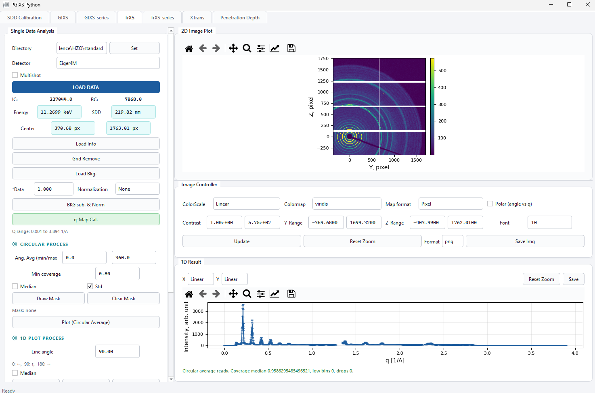

### 3.1 왼쪽 패널 — 공통 섹션

**Directory / Set**

- **Directory** 입력창 + **Set** 버튼 — LOAD DATA/Load Info/Load Bkg.가 여기서 시작.

**Detector**

- **Detector** 콤보 (모드별 목록은 위 표 참고).
- **Multishot** 체크박스 — 켜면 같은 시리즈(파일명 뒤 `_NNNN` 인덱스를 뗀 나머지가 같은 파일들)를 모두 평균해서 하나로 불러온다. LOAD DATA와 Load Bkg. 둘 다에 적용됨.

**LOAD DATA**

- **LOAD DATA** 버튼 (강조 버튼) — 파일을 선택해 불러온다(Multishot이면 백그라운드에서 평균 처리, 진행률 다이얼로그 표시). 불러오면 IC/BC 카운터가 채워지고, q-Map/Grid-Remove의 "완료" 표시가 초기화되며, Q range/Azimuthal Q 라벨이 리셋되고, Circular mask 상태(TrXS)가 지워지고, Map format이 Pixel로 리셋되고, 이전에 그려둔 오버레이가 지워진다.
- **IC: / BC:** — 불러온 파일의 ion-chamber / beam-counter 값 표시.

**캘리브레이션 입력값**

- **Energy** (keV) / **SDD** (mm) 한 줄, **Center [y, z]** (px) — GIXS는 여기에 **FP**(Footprint, mm)도 같은 줄에 추가로 있다.
- **Load Info** 버튼 — SDD Calibration 탭에서 저장한 JSON 파일을 불러와 위 필드들(+GIXS는 입사각까지)을 채운다. 이후 픽셀 축 표시가 "빔 중심 기준"으로 바뀐다.
- **Grid Remove** 버튼 — 검출기별 그리드 라인 보정을 적용한다 (Eiger4M 기준 픽셀 인덱스로 보정).

**입사각(Incidence Angle) 캘리브레이션 — GIXS만**

- **ai [deg] / y-pos** 줄 — y-pos(빔에서 몇 픽셀 떨어진 column인지) + **z-plot** 버튼(그 column의 세로 방향 강도 프로파일을 1D Result에 그림 — specular 피크를 눈으로 찾기 위함).
- **pixel / degree** 줄 — 입사각을 픽셀 오프셋과 각도(deg) 양쪽으로 표시. 한쪽을 바꾸면 다른 쪽도 자동 계산되어 갱신된다 (`atan((pixel*pixel_mm)/SDD)/2` 관계).

**Background / Normalization**

- **Load Bkg.** 버튼 — 백그라운드 프레임을 불러온다(Multishot 옵션 반영).
- **\*Data / Normalization** 줄 — `plus_data`(배경에 곱해줄 배율) + Normalization 콤보(`None`/`IC`/`BC`).
- **BKG sub. && Norm** 버튼 — 먼저 미리보기(preview)를 계산해서 2D Image Plot에 바로 보여주고, "Preview computed. Keep this background-subtracted/normalized result?" 확인창이 뜬다. **No**를 누르면 원래(변경 안 된) 이미지로 되돌아가고, **Yes**를 누르면 확정되어 Contrast가 자동 재설정되고 Map format이 Pixel로 리셋되며, q-Map Cal.을 다시 실행해야 한다는 표시가 뜬다(보정된 데이터가 정규화 이전 값으로 계산돼 있어서 그대로 두면 최신 값을 안 씀).

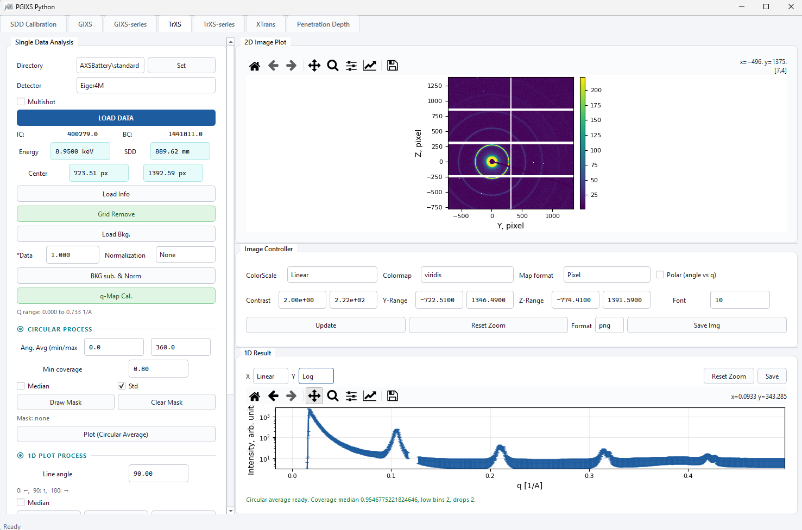

**Map format / q-Map Cal.**

- Map format 콤보(모드별 옵션은 위 표 참고). GIXS에는 "q uncertainty" 체크박스도 같은 줄에 있는데, 실제로는 아무 기능에도 연결돼 있지 않다(사용 안 해도 됨).
- **q-Map Cal.** 버튼 — Energy/SDD/Center/(GIXS는 입사각·Footprint까지) 기준으로 pixel→Q 변환을 계산한다. 완료되면 **Q range: … to … 1/A** 라벨이 갱신되고, Map format 전환과 Polar 뷰가 가능해진다.

### 3.2 왼쪽 패널 — TrXS 전용: Circular Process

TrXS의 대표적인 1D 처리 방식이다 (GIXS에는 없는 섹션).

- **Ang. Avg (min/max)** — 평균낼 각도 범위(기본 0°~360°). 값을 바꾸면 2D 이미지 위에 섹터 경계선이 실시간으로 그려진다.
- **Min coverage** — 이 값보다 커버리지(유효 픽셀 비율)가 낮은 q-bin은 NaN 처리한다 (기본 0.80).
- **Median** / **Std** 체크박스 — 평균 대신 중앙값 사용 / 표준편차도 함께 계산.
- **Draw Mask** 버튼 — 별도의 큰 다이얼로그 창이 열리고, 2D 이미지 위에 폴리곤을 클릭으로 그린다(더블클릭 또는 시작점 재클릭으로 닫힘). 폴리곤 **안쪽**은 Circular Average 계산에서 제외된다. Map format이 Pixel이어야 사용 가능.

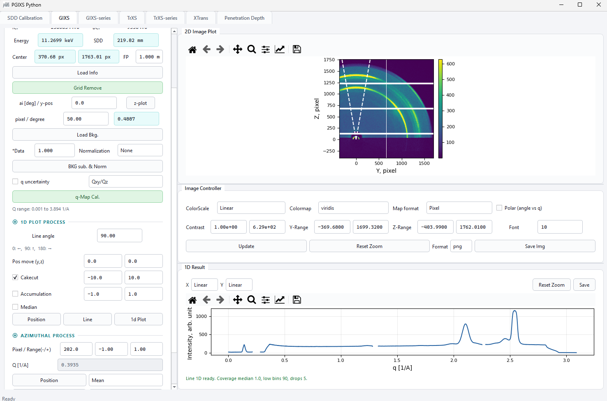

- **Clear Mask** 버튼 — 마스크 해제.
- **Plot (Circular Average)** 버튼 — 지정한 각도 범위(+마스크)로 q-binned 평균을 계산해 1D Result에 그린다.

### 3.3 왼쪽 패널 — 1D Plot Process (공통, 옵션 차이 있음)

- **Line angle** — 기본 90°. 도움말: "0: ←, 90: ↑, 180: →".
- **Pos move (y,z)** — GIXS만 있음. 컷 라인을 빔 중심에서 얼마나 offset할지. angle이 0/180°일 때는 z만, 90°일 때는 y만 움직이고, 그 외 각도에서는 무시된다(Cakecut에는 영향 없음). TrXS는 항상 빔 중심을 지나므로 이 필드 자체가 없다.
- **Cakecut** 체크박스(GIXS만) + minus/plus 각도 범위 — 기준 각도를 중심으로 한 각도 쐐기(wedge) 컷.
- **Accumulation** 체크박스(GIXS만) + minus/plus — 컷 라인에 수직인 픽셀 밴드 평균. 각도가 0/90/180일 때만 사용 가능. Cakecut과 동시에 켤 수 없다(하나 켜면 다른 하나는 자동으로 꺼짐).
- **Median** 체크박스 — 공통.
- **Position** / **Line** / **1d Plot** 버튼 — Position은 2D 이미지를 클릭해 Line angle을 설정하는 모드를 켠다. Line은 실제 컷을 실행하지 않고 현재 설정된 라인/쐐기/밴드 오버레이만 그린다. **1d Plot**이 실제로 컷을 계산(`console_line_1d`)해서 q vs. intensity를 1D Result에 그린다.

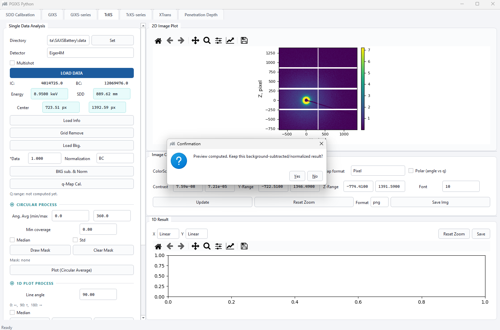

### 3.4 왼쪽 패널 — Azimuthal Process (공통)

- **Pixel / Range(-/+)** — 빔 중심에서 이 픽셀 반경 ± Range만큼의 링(밴드)을 지정.
- **Q [1/A]** — 현재 Azimuthal pixel 반경에 해당하는 Q값을 자동으로 표시(읽기 전용).
- **Position** 버튼 + **Mean/Median** 콤보 — Position은 클릭한 지점의 빔 중심까지 거리로 반경을 설정. Mean/Median은 각도별 평균 방식 선택.
- **Draw** 버튼 — pixel±range 두 원을 2D 이미지에 그린다(Qxy/Qz 표시 모드면 Q 반경으로 자동 환산해서 그림).
- **Plot** 버튼 — 각도별로 binning한 intensity를 계산해서 angle [deg] vs. intensity를 1D Result에 그린다. **GIXS는 0~180°만 스윕**(grazing incidence 특성상 수평선 위쪽만 산란), **TrXS는 0~360° 전체**를 스윕한다.


### 3.5 오른쪽 패널

**2D Image Plot**

- ColorScale(`Linear`/`Log`), Colormap, **Map format**(Pixel/Qxy/Qz/Qy/Qz 또는 Pixel/Qy/Qz), **Polar (angle vs q)** 체크박스(Qxy/Qz 또는 Qy/Qz 플롯을 극좌표(각도 vs |Q|)로 바꿔 보기 — q-Map Cal.을 해야 활성화됨).
- Contrast(cmin/cmax, 과학적 표기법), Y-Range, Z-Range, Font(축 폰트 크기) — 전부 즉시 반영.
- **Update** 버튼 — Y-Range/Z-Range를 전체 범위로 리셋(다른 설정은 그대로 유지). 화면에 그려져 있던 Position/Draw 오버레이도 함께 지워지고 Position 모드도 해제된다.
- **Reset Zoom** 버튼 — 확대/축소를 마지막 렌더링 범위로 리셋.
- Format 콤보(`png`/`jpg`/`pdf`/`svg`) + **Save Img** 버튼 — `_2Dinfo.h5`(2D 데이터+q맵+캘리브레이션) 저장과 함께, 현재 화면을 선택한 형식의 이미지 파일로도 저장.

**1D Result**

- X/Y 축 스케일 콤보(`Linear`/`Log`).
- **Reset Zoom** 버튼.
- **Save** 버튼 — 현재 1D 커브를 CSV로 저장하고, 같은 이름의 PNG도 함께 저장.
- 아래에 커버리지 진단 등의 상태 텍스트가 표시된다 (예: "Line 1D ready. Coverage median …, low bins …, drops …").

> 참고: 단일 프레임 GIXS/TrXS 탭에는 별도의 "ROI" 섹션이나 "Play"(프레임 재생) 버튼이
> 없다. 이 두 기능은 아래 4장/5장의 **GIXS-series**/**TrXS-series** 탭에만 있다.

### 3.6 작업 순서 정리

1. (선택) Directory 설정 → **LOAD DATA** (Multishot 옵션 선택 가능).
2. **Load Info**로 SDD Calibration에서 저장한 캘리브레이션 불러오기.
3. (선택) **Grid Remove**.
4. GIXS만: **z-plot**으로 입사각 피크를 찾아 pixel/degree 값 확정.
5. (선택) **Load Bkg.** → \*Data/Normalization 설정 → **BKG sub. && Norm** (미리보기 후 Yes/No로 확정/취소).
6. **q-Map Cal.** (Load Info를 먼저 해야 실행 가능) — pixel→Q 변환 계산.
7. TrXS만: **Circular Process**에서 각도 범위/Min coverage/Median·Std/필요시 Draw Mask 설정 후 **Plot (Circular Average)**.
8. **1D Plot Process**에서 Line angle(+GIXS는 Cakecut/Accumulation/Pos move) 설정, 필요시 Position/Line으로 미리보기, **1d Plot**으로 실행.
9. **Azimuthal Process**에서 Pixel/Range 설정, 필요시 Position/Draw, **Plot**으로 실행.
10. Image Controller/1D Result 컨트롤로 결과를 확인하고, **Save Img**/**Save**로 저장.

---

## 4. GIXS-series 탭

GIXS의 시리즈(여러 프레임을 한 번에) 버전이다. 시간/온도/각도 스캔 시리즈를 통째로
불러와서 프레임마다 같은 처리를 반복하고, 결과를 시리즈 곡선(matrix)으로 보여준다.

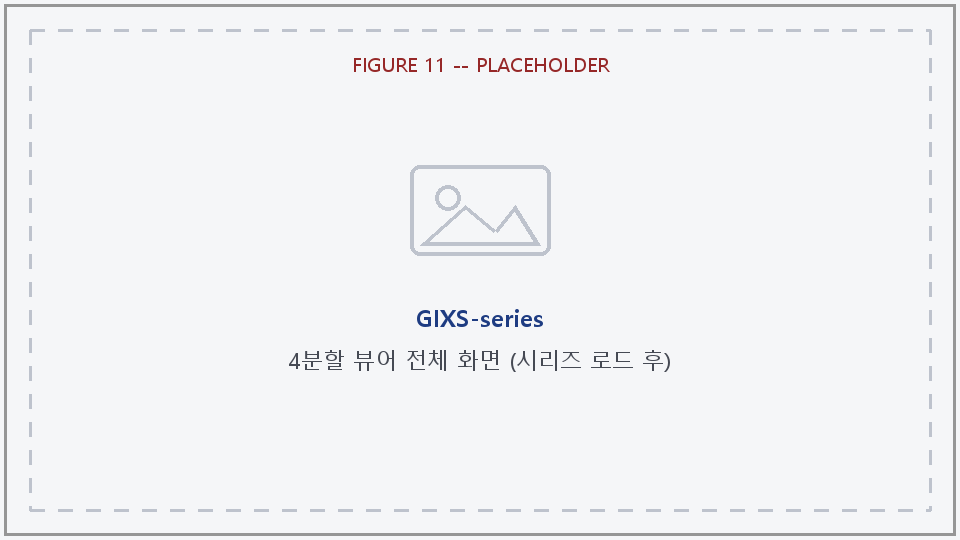

### 4.1 왼쪽 패널 — Serial Data Parameters / Load

- **Directory** + **Set** 버튼.
- **Detector** 콤보 (`Eiger4M`, `MarCCD`, `MX170HS`, `PI-CCD`).
- **Insitu** 콤보 — `Time` / `Temperature` / `Angle` / `LowTemp.`. 이 선택에 따라 나중에 X-Axis/Auto 섹션의 Sub-mode 콤보 항목이 바뀐다 (예: Temperature 선택 시 Temperature1/2/3 + Time).
- **LOAD DATA** 버튼 — 시리즈의 프레임 하나(.h5)를 선택하는 파일 다이얼로그가 열린다.
- **Filename** 입력창(파일명 접두어, 기본값 "ABCD") + **Set / Table** 버튼 — 같은 접두어를 가진 파일들을 전부 찾아서 **"File List (Series)"** 다이얼로그(체크박스 목록, Select All/Deselect All/Import/Cancel)를 연다. **Import**를 누르면 체크된 파일들을 전부 시리즈로 불러온다(진행률 다이얼로그 표시).

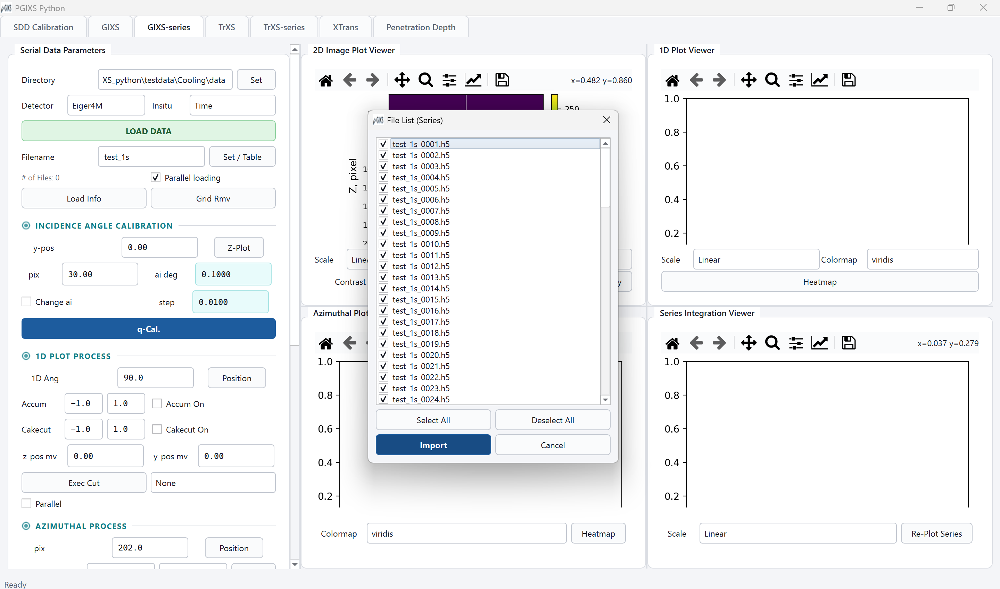

- **# of Files: 0** 라벨, **Parallel loading** 체크박스 (여러 파일을 스레드로 동시에 불러오기).
- **Load Info** 버튼 — 캘리브레이션 JSON을 불러오고, 2D 이미지 표시를 빔 중심 기준으로 재조정.
- **Grid Rmv** 버튼 — 시리즈 전체에 그리드 보정 적용.

### 4.2 Incidence Angle Calibration

- **y-pos** + **Z-Plot** 버튼 — 지정한 y-position에서 세로 방향 프로파일을 1D Plot Viewer에 그린다. 그 커브를 클릭하면 아래 **pix**가 설정된다.
- **pix** / **ai deg** — 서로 자동 연동되는 픽셀↔각도 필드.
- **Change ai** 체크박스 + **step** 필드 — 켜면 프레임마다 입사각이 고정된 step만큼씩 증가하는 것으로 처리한다(각도 스캔 시리즈용). 이 경우 q-Map도 프레임별로 따로 계산된다.
- **q-Cal.** 버튼 — 시리즈 전체의 Q-map을 계산한다(백그라운드 스레드 + 진행률 다이얼로그 "q-Cal"). Change ai가 꺼져 있으면 시리즈 전체가 공유하는 Q-map 하나만 계산하고, 켜져 있으면 프레임마다 따로 계산한다(더 오래 걸림).

### 4.3 1D Plot Process

- **1D Ang** + **Position** 버튼 — 각도 지정, 2D 이미지 클릭으로도 설정 가능.
- **Accum** minus/plus + **Accum On** 체크박스, **Cakecut** minus/plus + **Cakecut On** 체크박스 — 서로 배타적.
- **z-pos mv** / **y-pos mv** — 컷 위치를 빔 중심에서 얼마나 offset할지.
- 위 항목을 바꾸면(q-Cal 이후) 2D 이미지 위에 해당 오버레이가 실시간으로 그려진다(1D 또는 Azimuthal 중 하나만 항상 표시됨).
- **Exec Cut** 버튼 + **Normalize** 콤보(`None`/`IC`/`BC`) — 시리즈 전체에 대해 백그라운드로 컷을 실행(진행률 다이얼로그 "Exec Cut")하고 1D Plot Viewer를 그린다.
- **Parallel** 체크박스 — 프레임별 컷 계산을 여러 스레드로 동시에 처리.

### 4.4 Azimuthal Process

- **pix** + **Position** 버튼, **Range (-/+)** + **Draw** 버튼, **Mean/Median** 콤보 — 단일 프레임 콘솔과 동일한 개념.
- **Reflect missing wedge (Qxy/Qz)** 체크박스 — 켜면 각 프레임을 실제로 Qxy/Qz 그리드로 리그리딩한 뒤 컷을 계산해서, Qxy≈0 부근의 실제 커버리지 공백(missing wedge)이 커브에 끊김으로 반영된다. 기본은 꺼짐(빠른 pixel-space 컷, 공백 미반영) — 리그리딩은 더 느리고 "Change ai"가 아닌 일반 q-Cal이 필요하다.
- **Exec Azi** 버튼 + **Normalize** 콤보 — 시리즈 전체 azimuthal 프로파일을 백그라운드로 계산(진행률 다이얼로그 "Exec Azi").

### 4.5 Region of Interest

- **N. ROI** 콤보(1~5) + **Draw ROI** 버튼 — 별도 창이 열리고, ROI 개수만큼 사각형을 순서대로 드래그해서 그린다(빨강/초록/파랑/주황/보라 순으로 색이 자동 배정됨). 그리면 프레임별 ROI 합계가 계산되고, 2D 이미지 위에도 같은 색 사각형이 표시된다.

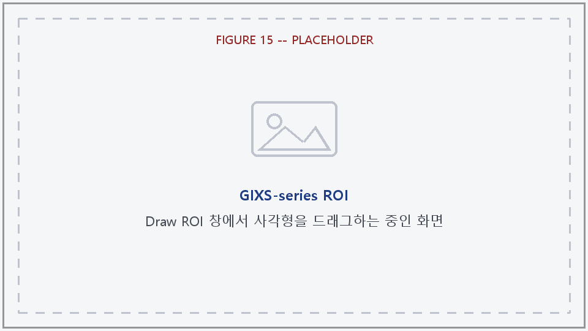

- **Normalize** 콤보(`None`/`IC`/`BC`) — Series Integration Viewer의 ROI 곡선에 적용.

### 4.6 X-Axis / Auto

- **Sub-mode** 콤보(Insitu 선택에 따라 항목이 바뀜) + **Order** 체크박스(X축 값 기준 정렬).
- **Set X-Axis** 버튼 — 시리즈의 실험 X축(시간/온도/각도/프레임 번호)을 계산해서 확정한다.
- **Auto Refresh (Find New)** 버튼 — 로드 디렉토리를 다시 스캔해서 아직 안 불러온 새 파일을 찾아 불러오고(백그라운드, 진행률 다이얼로그 "Auto Refresh"), 마지막으로 실행했던 처리(1D 컷 / Azimuthal / ROI)에 이어붙인다.

### 4.7 Save

- **Save 1D** — 1D Plot Viewer의 현재 정규화된 데이터 + PNG 저장.
- **Save Azi** — Azimuthal Plot Viewer 저장.
- **Save Integ.** — Series Integration Viewer 저장.
- **Save X-Axis** — 계산된 시리즈 X축 값만 저장.

### 4.8 오른쪽 패널 — 4분할 뷰어

- **2D Image Plot Viewer** (좌상단) — 불러온 전체 프레임의 평균("Average of N frame(s)"). Scale/Colormap, Contrast(0/0이면 자동), **Play** 버튼(프레임별로 하나씩 훑어보는 **"Frame Viewer (Play)"** 창이 열림 — 슬라이더로 프레임 넘기며 확인, 열 때의 Contrast/Colormap/Scale이 고정됨).

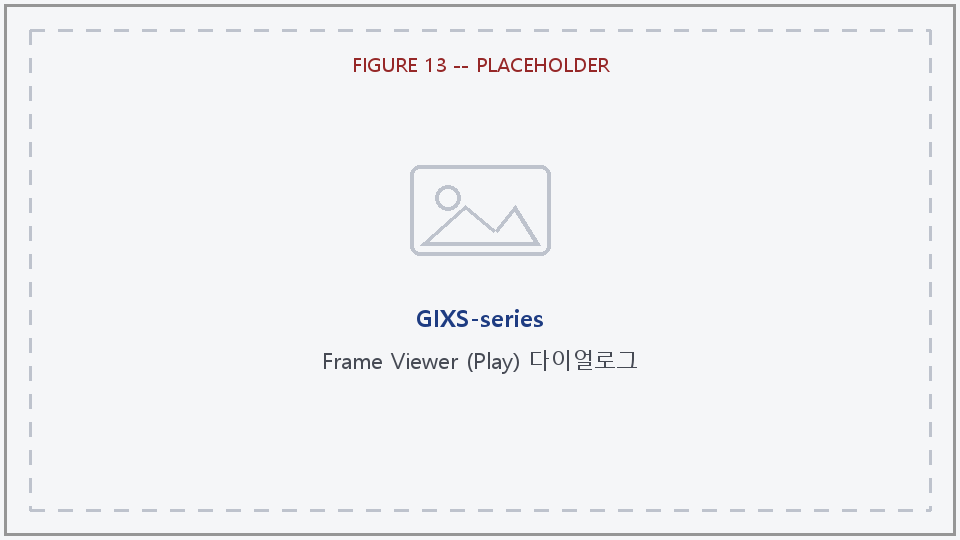

- **1D Plot Viewer** (우상단) — 프레임마다의 1D 컷 커브를 전부 겹쳐서, 시리즈 X축 값 기준 색상(colorbar)으로 표시. Scale(`Linear`/`Logy`/`Logxy`), Colormap, **Heatmap** 버튼(Q vs. X축 히트맵 창).
- **Azimuthal Plot Viewer** (좌하단) — 프레임별 azimuthal 프로파일을 같은 방식으로 표시. Colormap, **Heatmap** 버튼(Angle vs. X축 히트맵 창).
- **Series Integration Viewer** (우하단) — 프레임마다 적분값 하나를 X축에 대해 표시. ROI를 마지막으로 실행했으면 ROI별 곡선(색 매칭), 아니면 1D/Azimuthal 커브의 적분값. Scale, **Re-Plot Series** 버튼.

**Heatmap 다이얼로그** (1D/Azimuthal 공통 구조): Plot Type(`Heatmap`/`Surf`/`Waterfall`), Colormap, X/Y/Z Scale, Curtain Color(`Intensity`/`Frame Index`, Waterfall 전용), X Range/Y Range/Contrast, **Save Image** 버튼. 열었을 때 데이터를 스냅샷하며, 이후 Exec Cut/Exec Azi를 다시 돌려도 실시간으로 갱신되지 않는다.

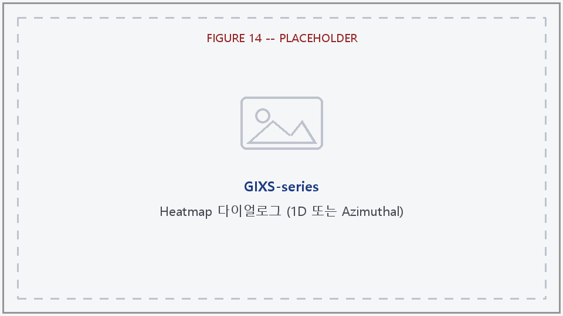

---

## 5. TrXS-series 탭

TrXS의 시리즈 버전. 구조는 GIXS-series와 비슷하지만 normal-incidence transmission
기하구조에 맞게 조정돼 있다.

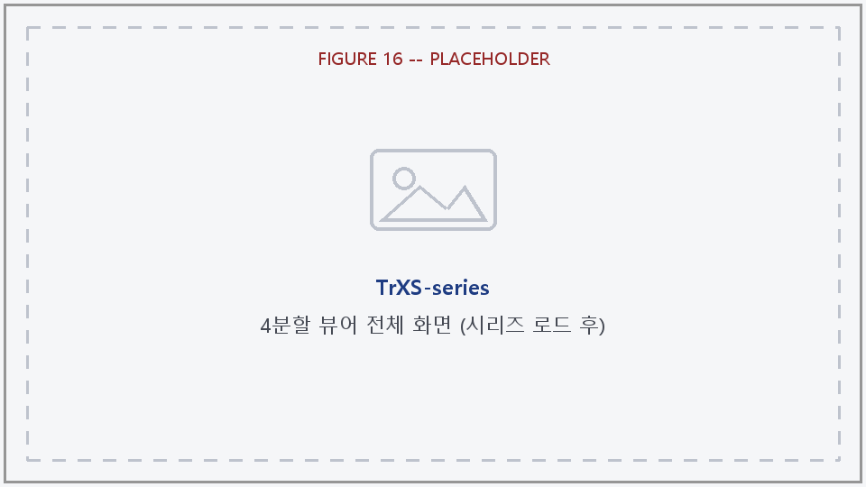

### 5.1 왼쪽 패널 — Serial Data Parameters (TrXS) / Load

- **Directory** + **Set**, **Detector**(`Eiger4M`/`MarCCD`/`MX170HS`/`PI_CCD`), **Exp.Mode**(`Time`/`Temperature`만 — 각도 스캔 개념이 없음).
- **LOAD DATA** 버튼 — GIXS-series와 달리, 새 시리즈를 불러와도 이미 불러온 **Background**는 그대로 유지된다.
- **Filename** + **Set / Table** 버튼 — 동일한 체크박스 파일 목록 다이얼로그.
- **# of Files: 0**, **Parallel** 체크박스.
- **Background** 버튼 — 배경 프레임 하나를 선택하면, 같은 시리즈 접두어를 가진 파일들을 전부 평균해서 배경 프레임으로 만들고, 본 스택과 같은 검출기 보정을 적용한다.
- **Subtraction** 체크박스 — 켜면 매 프레임 커브에서 배경의 커브를 실시간으로 빼서 보여준다(다시 계산할 필요 없이 즉시 반영).

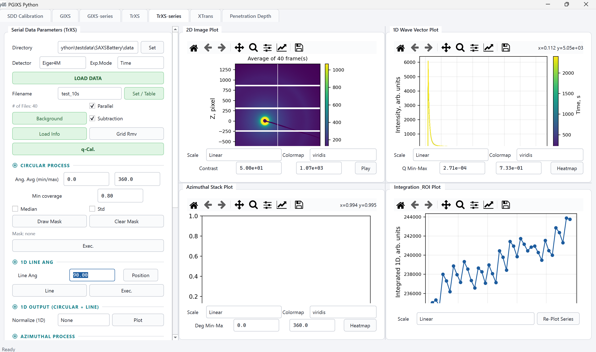

- **Load Info**, **Grid Rmv** — GIXS-series와 동일한 개념.
- **q-Cal.** 버튼 — GIXS-series와 달리 **입사각 캘리브레이션 자체가 없다** (TrXS는 normal-incidence transmission이라 필요 없음).

### 5.2 Circular Process (TrXS-series의 대표 1D 처리 — GIXS-series에는 없음)

- **Ang. Avg (min/max)** — 평균 각도 범위. 값을 바꾸면 2D 이미지에 섹터 경계가 실시간으로 그려진다.
- **Min coverage**, **Median** / **Std** 체크박스.
- **Draw Mask** 버튼 — 큰 별도 창("Draw Circular Average Mask")에서 폴리곤을 클릭으로 그려 제외 영역을 지정.
- **Clear Mask** 버튼, **Mask: none** 상태 라벨.
- **Exec.** 버튼 — 시리즈 전체에 Circular Average를 백그라운드로 실행(진행률 다이얼로그 "Circular Exec").

### 5.3 1D Line Ang

- **Line Ang** + **Position** 버튼 — GIXS-series의 1D Ang과 같은 개념. 단, **Cakecut/Accumulation/Pos move는 없다**(TrXS는 항상 빔 중심을 지나는 단순 각도 컷만 지원).
- **Line** 버튼 — 실행 없이 오버레이만 다시 그림.
- **Exec.** 버튼 — 백그라운드로 실행(진행률 다이얼로그 "Line Exec").

### 5.4 1D Output (Circular + Line 공용)

- **Normalize (1D)** 콤보(`None`/`IC`/`BC`) + **Plot** 버튼 — Circular Average와 1D Line Ang 둘 중 마지막으로 실행한 결과에 적용되며, 1D Wave Vector Plot / Save 1D도 이 설정 하나를 공유한다.

### 5.5 Azimuthal Process

- **pix** + **Point Find** 버튼(GIXS-series의 "Position"과 같은 기능, 이름만 다름), **Range (-/+)** + **Draw** 버튼, **Mean/Median** 콤보.
- **Exec.** 버튼 + **Normalize** 콤보 — TrXS-series의 Azimuthal Process에는 **"Reflect missing wedge" 체크박스가 없다** (GIXS-series에만 있음).

### 5.6 Region of Interest

- **N. ROI**(1~5) + **Draw ROI** 버튼 — GIXS-series와 동일하게 별도 창에서 사각형을 드래그해서 그린다.

### 5.7 Options (GIXS-series의 "X-Axis / Auto"에 해당)

- **Tmode** 콤보 — `Temperature1` / `Temperature2` / `Time` (고정 목록).
- **Temp.Sort** 체크박스.
- 별도의 "Set X-Axis" 버튼은 없다 — Tmode나 Temp.Sort를 바꾸면 이미 데이터가 있는 1D/Azimuthal 플롯이 즉시 다시 그려진다(그때그때 X축을 계산).
- **Auto Refresh (Find New)** 버튼 — GIXS-series와 동일한 개념(새 파일 탐색 → 불러오기/처리 → 마지막 처리에 이어붙임).

### 5.8 Save

- **Save 1D** — Circular Exec에서 Std를 체크했으면, 프레임별 데이터와 std 컬럼이 한 파일 안에 번갈아(interleave) 저장된다 (Q, frame1, frame1_STD, frame2, frame2_STD, …).
- **Save Azi**, **Save Integ.** + **Save X-Axis**.

### 5.9 오른쪽 패널 — 4분할 뷰어

- **2D Image Plot** (좌상단) — GIXS-series와 같은 Scale/Colormap/Contrast/Play 구성. 오버레이는 Circular 섹터 / Line Ang 라인 / Azimuthal 링 중 마지막 것 + ROI 박스.
- **1D Wave Vector Plot** (우상단) — Circular/Line 중 마지막 실행 결과, Subtraction이 켜져 있으면 실시간 반영. Scale, Colormap, **Q Min-Max** 범위, **Heatmap** 버튼.
- **Azimuthal Stack Plot** (좌하단) — Scale, Colormap, **Deg Min-Max**(기본 0~360°, GIXS-series의 반원 기본값과 다름), **Heatmap** 버튼.
- **Integration & ROI Plot** (우하단) — Scale, **Re-Plot Series** 버튼.

Play/Heatmap 다이얼로그의 컨트롤 구성은 GIXS-series와 동일하다.

---

## 6. XTrans 탭

검출기 이미지를 불러오지 않는 독립 계산기. 화학식과 밀도를 입력하면 광자 에너지
범위에 걸쳐 투과율/임계각/SLD를 계산한다. MATLAB 버전의 `XTrans_GUI.m`과 동일한 워크플로우를 따르며, 내부적으로
CXRO/Henke 산란인자 테이블 기반의 `refrac()` 함수를 사용한다.

### 6.1 입력

- **Chem. Formula** — 화학식 문자열(예: `C8H8`, `SiO2`). 대소문자 구분, 괄호/수화물 표기는 지원 안 함.
- **Density, g/cm3** — 밀도 (기본 1.05).
- **Thickness, um** — 시료 두께 (기본 100.0) — Transmittance 모드에서만 사용됨.
- **Energy Min / Max** — 광자 에너지 스윕 범위 (keV, 0.03~30 범위 내, 기본 8.5~15.0).
- **# of points** — 스윕 포인트 개수 (기본 50).
- **Mode** 콤보 — `Transmittance` / `Critical Angle` / `SLD (Real)` / `SLD (Imag)`.
- **RUN CALCULATION** 버튼 — 선택한 물리량을 에너지 스윕 전체에 대해 계산해서 그린다.

### 6.2 결과

- **Transmittance**: `exp(-두께mm / attenuation length mm)` — 0~1 사이 값.
- **Critical Angle**: 전반사 임계각 (deg).
- **SLD (Real)** / **SLD (Imag)**: 산란길이밀도 실수부/허수부 (×10⁻⁶ Å⁻²).
- 네 모드 모두 X축은 Photon Energy (keV)로 공통.
- 계산 후 상태줄에 **분자량(g/mol)**과 **분자당 전자 수**가 함께 표시된다.

### 6.3 저장

- **Directory** + **Set** 버튼.
- **Data Table** 버튼 — 계산된 모든 포인트를 표로 보여주는 창.
- **Save Data** 버튼 — `{Mode}_{EnergyMin}_to_{EnergyMax}.dat` 형식으로 저장.

### 6.4 플롯

- **Result Plot** — 계산된 값 vs. 에너지 커브.
- **Controls** — X Scale(`linear`/`log`), Y Scale(`linear`/`log`), Grid On 체크박스 — 모두 재계산 없이 즉시 반영.

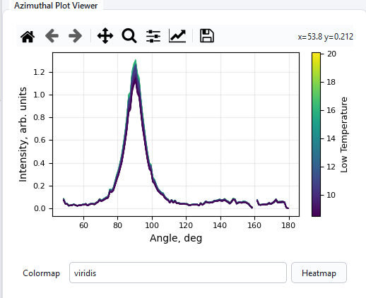

---

## 7. Penetration Depth 탭

역시 독립 계산기. 고정된 광자 에너지에서 입사각(incidence angle) 범위에 따른
X-ray 침투 깊이를 계산한다. MATLAB 버전의 `Penetration_GUI.m`과 동일한 워크플로우를 따르며, XTrans와 마찬가지로
`refrac()`을 사용한다.

### 7.1 입력

- **Chem. Formula** (기본 `Si`), **Density, g/cm3** (기본 2.329).
- **Energy, keV** — 고정된 단일 에너지 (스윕 아님, 기본 11.3).
- **Angle Min / Max** — 입사각 스윕 범위 (deg, 기본 0.0~1.0, 내부적으로 200 포인트로 샘플링).
- **RUN CALCULATION** 버튼.

### 7.2 정보 / 결과

계산 후 아래 라벨이 갱신된다.

- **Delta: -** — dispersion δ.
- **Beta: -** — absorption β.
- **Critical Angle: -** — 임계각 (deg).
- 상태줄에 사용된 파장(Å)도 표시된다.

침투 깊이는 다음 공식으로 계산된다 (θᵢ는 스윕 중인 입사각, θc는 임계각, 라디안 기준):

```
inner = sqrt((θi² - θc²)² + 4β²)
Lp[Å] = λ / [ (4π/√2) · sqrt(inner - (θi² - θc²)) ]
depth[nm] = Lp / 10
```

### 7.3 저장

- **Directory** + **Set**, **Data Table** 버튼(컬럼: `Incidence_Angle_deg` / `Penetration_Depth_nm`), **Save Data** 버튼 — `PenetrationDepth_{AngleMin}_to_{AngleMax}.dat`.

### 7.4 플롯

- **Result Plot** — Penetration Depth (nm) vs. Incidence Angle (deg), **임계각 위치에 빨간 세로 기준선**이 함께 그려진다 (임계각 전후로 깊이가 어떻게 달라지는지 한눈에 보기 위함).
- **Controls** — Y Scale(`linear`/`log`) — X축(각도)은 항상 linear라 X Scale 콤보는 없다. Grid On 체크박스.

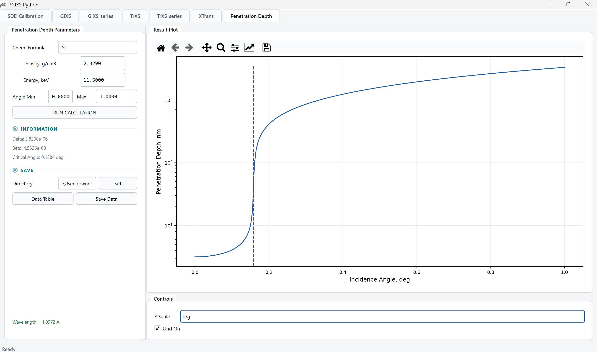

---

## 8. 공통 개념 정리

| 용어 | 의미 |
| --- | --- |
| **q-Map Cal. / q-Cal** | 검출기 픽셀 좌표를 Q-space(역격자 공간) 좌표로 변환하는 계산. GIXS는 입사각을 반영해서 Qxy/Qz를 계산하고, TrXS는 normal-incidence 기준으로 Qy/Qz를 계산한다. |
| **Map format (Pixel / Qxy·Qy / Qz)** | 2D 이미지를 픽셀 좌표로 볼지, Q-space 균일 그리드로 리그리딩해서 볼지 선택. Q-space 모드에서는 Line/Cake/Accumulation/Azimuthal 컷이 실제로 리그리딩된 이미지를 잘라서 pixel-space와 독립적인 결과를 낸다. |
| **Grid Remove** | Eiger4M 등 일부 검출기의 물리적 모듈 간격(그리드)을 보정하는 처리. |
| **Background / Normalization** | 배경 프레임을 빼고(subtraction), IC(ion chamber)/BC(beam counter) 값으로 정규화하는 처리. |
| **Cakecut / Accumulation** | (GIXS 1D 컷 전용) Cakecut은 기준 각도 주변의 각도 쐐기(wedge) 평균, Accumulation은 컷 라인에 수직인 픽셀 밴드 평균. |
| **Circular Average** | (TrXS 전용) 지정한 각도 범위에서 q-binned 평균 — TrXS의 기본 1D 처리 방식. |
| **Azimuthal Process** | 고정된 반경(pixel/Q)에서 각도별 강도 분포를 뽑는 처리. GIXS는 0~180°, TrXS는 0~360°를 스윕. |
| **Coverage** | 각 q-bin/angle-bin에 실제로 몇 %의 유효 픽셀이 있었는지 나타내는 진단값. 검출기 갭이나 마스크 때문에 커버리지가 낮은 구간은 커브에 끊김/딥으로 나타날 수 있다. |
| **Missing wedge** | Qxy≈0 부근에서, 균일 Q-grid로 리그리딩할 때 실제 픽셀 샘플링이 성기어져 생기는 커버리지 공백. GIXS-series Azimuthal Process의 "Reflect missing wedge" 옵션으로 반영할 수 있다. |
| **ROI (Region of Interest)** | 2D 이미지 위에 사각형을 그려서 그 영역의 합계를 프레임별로 추적하는 기능 (series 탭에만 있음). |
| **Auto Refresh** | 로드 디렉토리를 다시 스캔해서 새로 생긴 시리즈 파일을 찾아 불러오고, 마지막 처리에 이어붙이는 기능 (series 탭에만 있음). |

---

## 9. 문제 해결

- **q-Map Cal. / q-Cal이 안 눌러진다** → 먼저 **Load Info**로 캘리브레이션을 불러와야 한다. Load Info 없이는 q-Cal이 막혀 있다.
- **BKG sub. && Norm.을 눌렀는데 이미지가 안 바뀐다** → q-Map Cal.을 이미 한 번 실행한 상태라면, 정규화 후에는 q-Map Cal.을 다시 눌러야 보정된 이미지가 최신 데이터로 갱신된다(안내 표시가 뜬다).
- **Qxy/Qz 모드에서 클릭한 위치와 다른 곳에 라인/포지션이 잡힌다** → 최신 버전에서 수정된 문제다. 앱을 최신 릴리스로 업데이트했는지 확인한다.
- **XTrans/Penetration Depth에서 "Element 'X' is NOT in the table list" 에러** → v0.1.1 이전 배포판에서 데이터 파일 누락으로 발생하던 문제로, 이후 버전에서 수정됐다. 최신 릴리스를 받아서 다시 실행한다.
- **Azimuthal 커브가 예상과 다르게 매끈하다 (missing wedge가 안 보임)** → GIXS-series라면 Azimuthal Process의 **Reflect missing wedge (Qxy/Qz)** 체크박스를 켜야 실제 커버리지 공백이 반영된다 (기본은 꺼짐).
- **macOS에서 처음 실행 시 "확인되지 않은 개발자" 경고** → README의 macOS 안내(우클릭 → 열기, 또는 `xattr -d com.apple.quarantine PGIXS.app`)를 참고한다.
- 그 외 문제는 GitHub 리포지토리의 Issues에 재현 방법과 함께 남겨준다.
