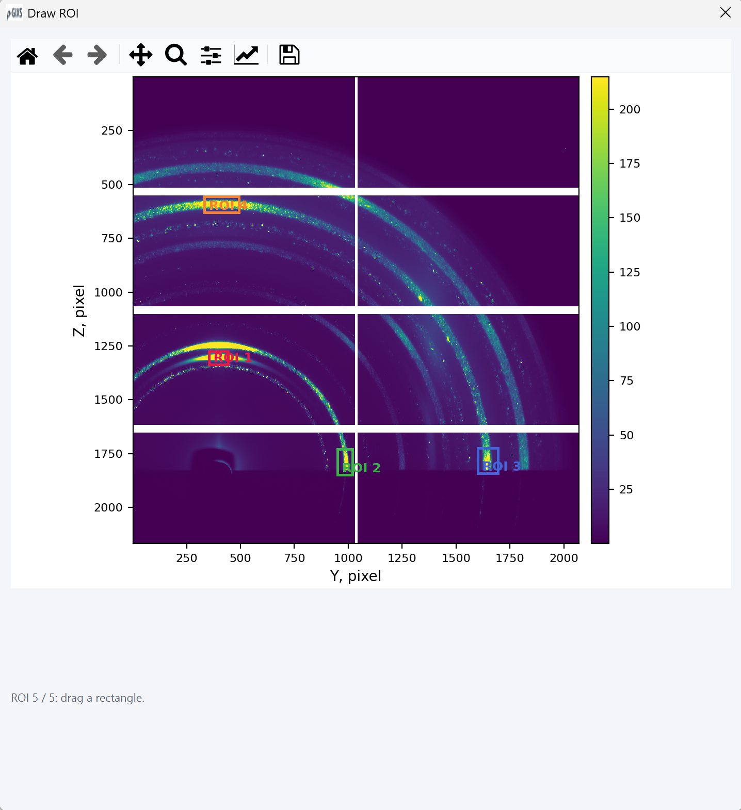
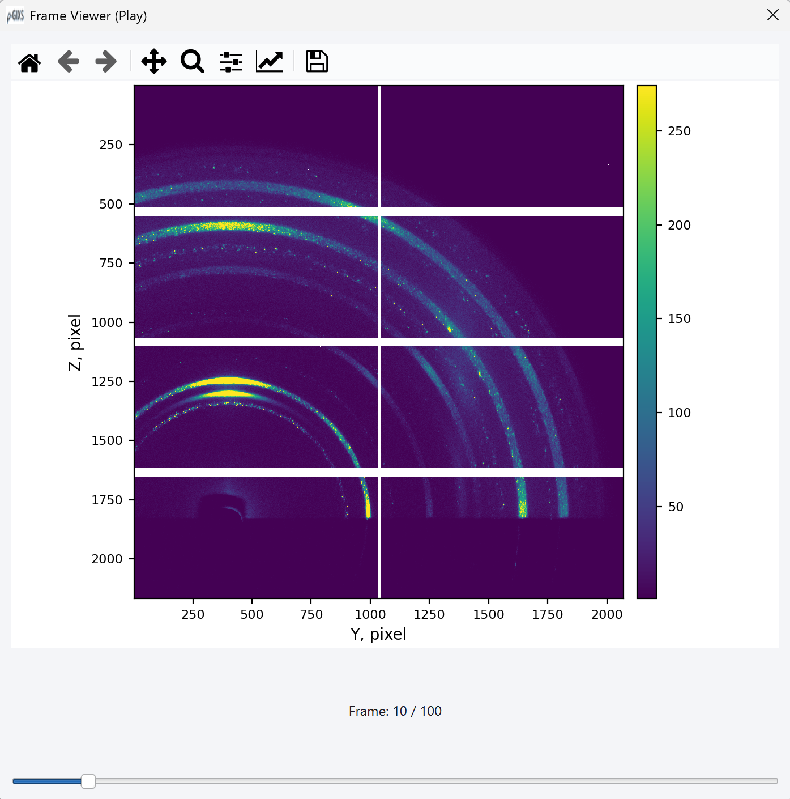
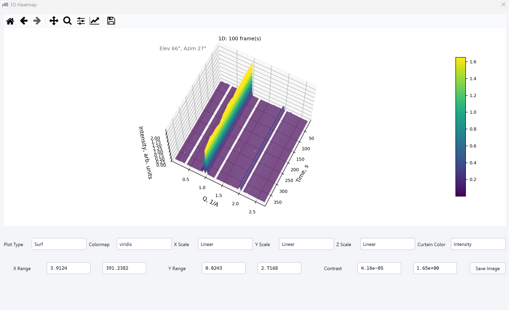
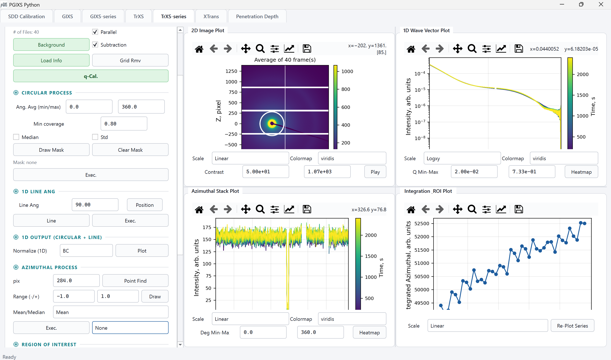
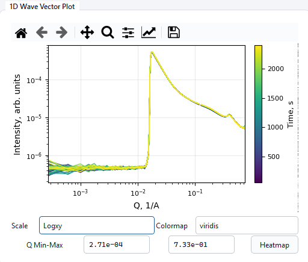
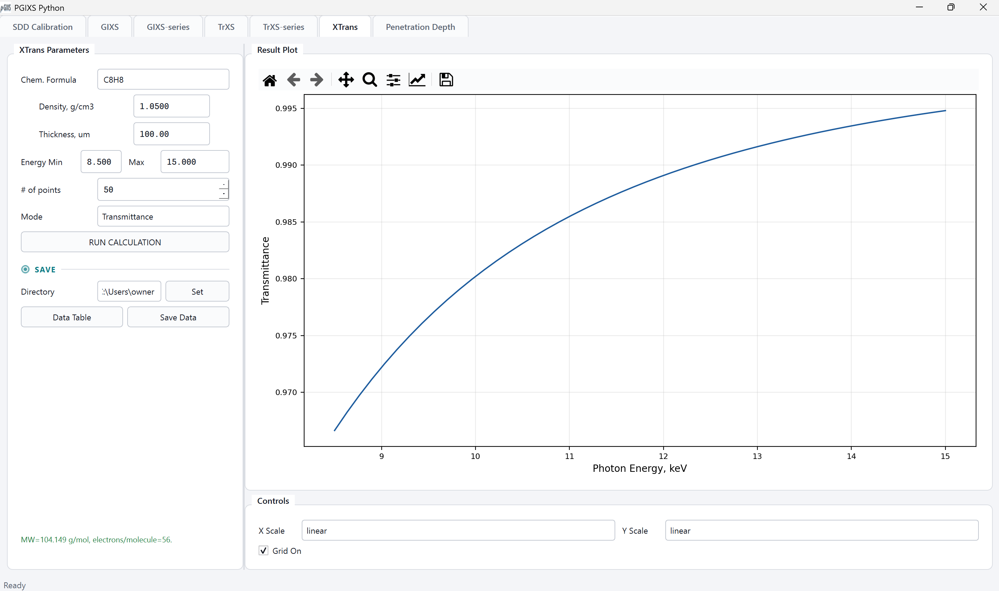
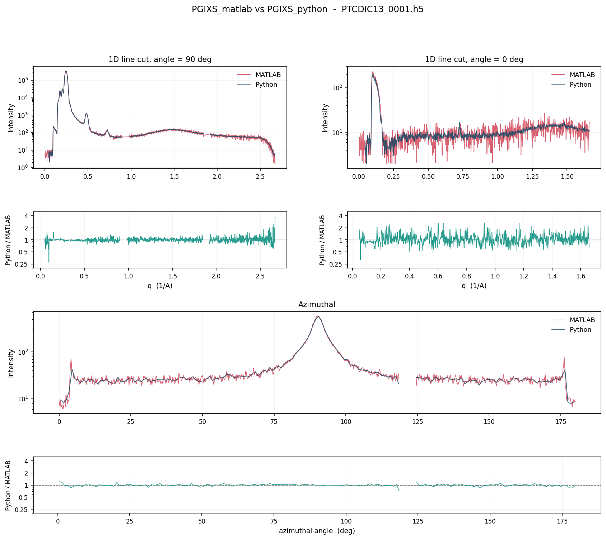

# PGIXS Python 데스크탑 앱 사용자 매뉴얼

PGIXS는 **MATLAB 버전**과 **Python 버전** 두 가지로 제공된다. 이 문서는 그중
Python 버전(PySide6 데스크탑 GUI)의 상세 사용자 매뉴얼이다. MATLAB 버전과 기능이
동등하며, MATLAB 라이선스 없이 Windows/macOS/Linux 어디서나 실행할 수 있다. 앱은
**SDD Calibration / GIXS / GIXS-series / TrXS / TrXS-series / XTrans /
Penetration Depth** 7개 탭으로 구성된다.

> 설치/다운로드 방법은 리포지토리 루트의 `README.md`를 참고한다 (Windows/macOS/Linux
> 실행 파일을 Releases 페이지에서 받거나, 소스에서 `python -m pgixs_python.desktop.app`로
> 직접 실행할 수 있다).

---

## 목차

1. [전체 구조와 사용 순서](#1-전체-구조와-사용-순서)
2. [SDD Calibration 탭](#2-sdd-calibration-탭)
3. [GIXS / TrXS 탭 (공통 콘솔)](#3-gixs--trxs-탭-공통-콘솔)
4. [GIXS-series 탭](#4-gixs-series-탭)
5. [TrXS-series 탭](#5-trxs-series-탭)
6. [XTrans 탭](#6-xtrans-탭)
7. [Penetration Depth 탭](#7-penetration-depth-탭)
8. [공통 개념 정리](#8-공통-개념-정리)
9. [문제 해결](#9-문제-해결)
10. [부록: MATLAB 버전과 결과 비교하기](#10-부록-matlab-버전과-결과-비교하기)

---

## 1. 전체 구조와 사용 순서

프로그램 상단 탭은 다음 순서로 배치돼 있다.

| 순서 | 탭 이름 | 용도 |
| --- | --- | --- |
| 1 | **SDD Calibration** | 캘리브런트(예: Silver behenate) 링 패턴으로 sample-to-detector distance(SDD)를 구하는 독립 도구. 실제 실험에서 GIXS/TrXS 분석보다 먼저 해야 하는 작업이라 맨 앞에 있다. |
| 2 | **GIXS** | 단일 프레임 grazing-incidence 데이터 처리 콘솔. |
| 3 | **GIXS-series** | GIXS의 시리즈(시간/온도/각도 스캔) 버전 — 프레임 여러 장을 한 번에 불러와 프레임별 커브를 계산. |
| 4 | **TrXS** | 단일 프레임 transmission 데이터 처리 콘솔. |
| 5 | **TrXS-series** | TrXS의 시리즈 버전. |
| 6 | **XTrans** | 화학식 기반 X-ray 투과율/임계각/SLD 계산기 (검출기 이미지와 무관한 독립 계산기). |
| 7 | **Penetration Depth** | 특정 입사각 범위에서의 X-ray 침투 깊이 계산기 (역시 독립 계산기). |

**일반적인 실험 순서**는 다음과 같다.

1. **SDD Calibration**에서 캘리브런트 이미지를 불러와 SDD를 구하고 캘리브레이션 파일(JSON, `.mat`/`.std` 동반 파일)을 저장한다.
2. **GIXS** 또는 **TrXS**(단일 프레임을 빠르게 확인할 때) / **GIXS-series** 또는 **TrXS-series**(여러 프레임을 한 번에 처리할 때)에서 데이터를 불러오고, 위에서 저장한 캘리브레이션 파일을 **Load Info**로 불러온다.
3. 필요하면 Grid Remove, Background subtraction/Normalization을 적용한다.
4. **q-Cal / q-Map Cal.**로 pixel → Q 변환을 계산한다.
5. Line/Cakecut/Accumulation/Circular Average/Azimuthal Process/ROI 등으로 1D 커브를 뽑고 저장한다.
6. 필요하면 **XTrans**/**Penetration Depth**에서 시료의 투과율·임계각·침투 깊이를 별도로 계산해 실험 조건(에너지, 두께, 입사각 범위)을 잡는 데 참고한다.

같은 `ConsoleWidget` 클래스를 GIXS/TrXS가 공유하고, GIXS-series/TrXS-series도 구조가
비슷하므로, 아래 3장/4장/5장은 "공통 설명 + 모드별 차이" 형태로 정리했다.

GIXS 탭이나 TrXS 탭에서 파일을 불러오는 동안에는(백그라운드 로딩 중) 다른 탭으로
전환할 수 없다 — 두 콘솔이 내부적으로 같은 세션 슬롯을 공유하기 때문에, 로딩 도중
전환하면 데이터가 꼬일 수 있어서 막아둔 것이다.

---

## 2. SDD Calibration 탭

MATLAB 버전의 `SDDcal_gui.m`(+ `OneDplotpixel_gui.m`/`OneDplotpixelR_gui.m`)과
동일한 워크플로우를 따른다. 캘리브런트 링 이미지를 불러와서 빔 중심을 잡고, 방사형(radial) 또는 라인 프로파일을
뽑아 링 피크를 가우시안 피팅한 뒤 SDD를 계산하고, GIXS/TrXS의 **Load Info**가 읽는
캘리브레이션 파일을 저장하는 탭이다.

### 2.1 왼쪽 패널

**상단 (LOAD DATA)**

- **Directory** 입력창 + **Set** 버튼 — 폴더 선택 다이얼로그. 이후 LOAD IMAGE DATA가 여기서 시작한다.
- **Detector** 콤보 — `Eiger4M`, `MarCCD`, `MX170HS`, `PI-CCD`, `MAR345` 중 선택.
- **LOAD IMAGE DATA** 버튼 — 캘리브런트 이미지를 불러온다. 불러오면 Center [Y, Z]가 자동으로 채워지고, 범위/커브/피팅 상태가 초기화된다.


**Manual Calibration**

- **Center [Y, Z]** — 빔 중심 좌표 두 필드.
- **Set C** 버튼 — 2D 이미지를 클릭해서 그 위치를 중심으로 설정.


- **Update Center** 버튼 — 위 Center [Y, Z]에 직접 입력한 값을 그대로 적용.
- **Y_Plot (Fit)** / **Z_Plot (Fit)** — 현재 중심을 지나는 Y방향/Z방향 라인 프로파일을 뽑아 "1D Result" 패널에 그린다.
- **Rad.Ave (Fit)** — 중심 기준 방사형(azimuthal 평균) 프로파일을 뽑는다.

**Peak Fit**

- **Fit Mode** 콤보 — `Single Peak` / `Symmetric Peaks (+/-)`. Symmetric 모드는 Y_Plot/Z_Plot 라인 컷에만 적용되고 Rad.Ave에는 적용되지 않는다.
- **1. Select Data Range** 버튼 — 1D 커브 위에서 범위를 클릭으로 지정한다. Single 모드는 시작→끝 2번 클릭, Symmetric 모드는 왼쪽 피크 시작/끝 → 오른쪽 피크 시작/끝 총 4번 클릭한다.
- **2. Gaussian Fit Peak(s)** 버튼 — 선택한 범위에 가우시안 피팅을 실행하고, 피팅 커브를 커브 위에 겹쳐 그린다(Single은 빨강, Symmetric은 좌/우 각각 다른 색). 결과는 **Offset: -** 라벨에 표시되며(중심 위치, R², Symmetric은 반경까지), 방사형(radial) 커브였다면 **Pixel Radius**(아래 Calc SDD 섹션)도 자동으로 채워진다.
  - **피팅 모델**: `intensity = a·exp(-(x-b)²/(2c²)) + d`(진폭 a, 중심 b, 시그마 c, 상수 배경 d) 4-파라미터 가우시안 하나를 그대로 쓴다 — Single/Symmetric 둘 다 같은 모델이고, Symmetric은 이 모델을 좌/우 창에 각각 한 번씩 총 두 번 독립적으로 피팅한다. 초기값은 별도 사전 피팅 없이 모멘트 추정으로 잡는다: `offset0 = min(y)`, `amp0 = max(y) - offset0`, `center0`/`sigma0`은 `y - offset0`(0 이하는 0으로 클리핑)으로 가중한 x의 평균/표준편차. 선택 범위 안에 유효한(non-NaN) 포인트가 4개 미만이면 피팅 자체를 시도하지 않고 실패로 처리한다. `R²`는 `1 - SS_res/SS_tot`(SS_tot=0이면 NaN)로 계산한다.
  - **Symmetric 모드 계산**: 왼쪽 창 피팅 중심 `b_L`, 오른쪽 창 피팅 중심 `b_R`로부터 `center_offset = (b_L + b_R) / 2`(빔 중심 오프셋)와 `ring_radius = |b_R - b_L| / 2`(피크 간격의 절반 = 링 반경)를 계산한다.
- **Offset: -** — 마지막 피팅 결과 표시 라벨.
- **Apply to Center** 버튼 — 방금 한 Y_Plot/Z_Plot 피팅 결과(offset)를 Center [Y, Z]에 반영한다.


**Smart Auto Run**

- **SMART AUTO RUN** 버튼 — Center [Y, Z]가 대략 맞은 상태에서 누르면, 빔 중심을 자동으로 미세 조정하고, 캘리브레이션 링들을 자동으로 탐색해서 SDD까지 한 번에 계산해준다(로컬 refinement이므로 중심이 너무 많이 틀어져 있으면 먼저 Manual Calibration으로 대략 맞춰야 한다).
- 결과 **후보 테이블**(Candidate table) — 컬럼: **Radius, Order, Coverage, R2, SDD, Use**. 찾은 링 후보들과 각각 채택 여부("Yes"/"No")가 표시된다.
  - **1단계 — 대략적인 피크 탐색**: 반경 프로파일에서 `반경 > 50px`이고 `coverage ≥ 0.80`인 구간만 남긴 뒤(그 안에서만 탐색), 전체 프로파일 최댓값의 3%를 prominence 기준으로 피크를 찾는다(최대 7개 후보). 유효 구간 사이에 빈 곳(gap)이 있어도 탐색 시퀀스에서는 이어붙여진 것처럼 취급된다.
  - **2단계 — 후보별 정밀 피팅**: 각 대략적 피크 위치를 중심으로 ±30px 창에서 위의 가우시안 모델로 다시 피팅해 정밀 반경과 R²를 구한다.
  - **3단계 — Order 배정과 채택 판정**: `Silver behenate`처럼 여러 회절 차수(order)가 동시에 보이는 표준물질은 "몇 번째 후보부터 몇 번째 order로 볼지"를 여러 조합으로 시도하고(다른 표준물질은 항상 1번 후보=1st order 하나만 시도), 각 조합에서 후보마다 Bragg's law로 SDD를 계산한 뒤 `R² ≥ 0.85`이고 `Coverage ≥ 0.80`인 후보만 "채택(Use=Yes)"한다.
  - **4단계 — 최적 조합 선택**: 채택된 후보들의 SDD 값이 서로 얼마나 흩어져 있는지(상대 표준편차)를 기본 점수로 삼고, 채택 개수가 많을수록 감점(더 신뢰), 이론상 보였어야 할 낮은 차수의 링이 안 보이는 조합일수록 가점(불리)해서 **점수가 가장 낮은 조합**을 최종으로 택한다. 최종 **SDD**는 채택된 후보들의 SDD 중앙값, 후보 테이블의 각 행은 이 최적 조합 기준의 결과다.
  - 대략적 피크가 하나도 안 잡히거나, 어떤 조합에서도 후보가 채택되지 않으면 SDD를 계산하지 못했다는 메시지가 뜬다.


**Calc SDD** (수동 계산 / Smart Auto Run과 공유되는 입력값)

- **Standard / Order** — Standard 콤보: `SEBS`, `Silver behenate`(기본값), `Mesoporous Silica`, `Sucrose`. Order 콤보: `1st`~`7th` (몇 번째 회절 링인지).
- **Energy [keV] / Pixel** — 사용한 X-ray 에너지, 그리고 측정된 링의 픽셀 반경(Pixel Radius — 수동 입력하거나 피크 피팅/Smart Auto Run에서 자동으로 채워짐).
- **Calc SDD** 버튼 — Pixel Radius + Order + Standard + Energy로 SDD를 수동 계산한다. 결과는 **Result: - mm** 라벨에 표시.
  - **계산 공식** (Bragg's law 기반): 먼저 표준물질의 q값을 `q = base_q(Standard) × Order`로 구한다(기준 q값은 `Silver behenate` 0.1052, `SEBS` 0.01916, `Mesoporous Silica` 0.059264, `Sucrose` 0.5933 Å⁻¹). 파장 `λ = 12.3984 / Energy[keV]` (Å)로 산란각 `θ = arcsin(q·λ / 4π)`을 구하고, `2θ`(deg)로 변환한 뒤 `SDD[mm] = Pixel Radius × pixel_size[mm] / tan(2θ)`로 계산한다. `arcsin`의 정의역을 벗어나거나(즉 q가 너무 크거나) `2θ`가 0 이하로 나오면 계산 실패 에러가 뜬다.

**Save**

- **Save Calibration** 버튼 — 캘리브레이션 값을 JSON(+ `.mat`/`.std` 동반 파일)으로 저장한다. 이 파일을 GIXS/TrXS 탭의 **Load Info**가 읽는다.
  - **빔 중심 좌표 관례**: 세 파일 모두 **1-based 픽셀 좌표**(첫 픽셀이 1)를 그대로 담는다. MATLAB 버전과 같은 관례이므로 어느 쪽에서 저장한 파일이든 그대로 주고받을 수 있다. 다만 **v0.1.1 이전 Python 빌드가 저장한 `.mat`/`.std`**와 **PGIXS_matlab 커밋 `89c4c85` 이전 MATLAB 빌드가 저장한 `.json`**은 빔 중심이 한 픽셀씩 어긋나 있다 — 해당 파일은 각 프로그램에서 다시 저장해야 한다.
  - **`{파일명}_standard.json`**: 이 앱 자체의 저장 형식. `pc`(빔 중심 [y,z]), `wavelength`, `pixelsize`, `sdd`, `dttypename`(검출기), `Energy`, `STpeak`/`STqvalue`(피팅된 링 반경/q값), `imgdim`(이미지 크기), `SDDDiagnostics`(Smart Auto Run 후보 테이블 전체)까지 포함한다 — **Load Info**가 실제로 읽는 파일.
  - **`{파일명}_standard.mat`** / **`{파일명}_standard.std`**: MATLAB 버전과 호환되는 보조 파일(`.mat`은 `SDDcal_gui.m`과 같은 필드명, `.std`는 MATLAB `stdsave.m`과 같은 5줄짜리 텍스트 포맷). `SDDDiagnostics`는 `.mat`에는 담기지 않는다(이기종 구조라 `.mat` 포맷으로 표현이 까다로움 — JSON에만 있음). 이 두 파일은 저장에 실패해도 JSON 저장 자체는 그대로 성공 처리된다(MATLAB 쪽 호환은 best-effort).

### 2.2 오른쪽 패널

- **2D Image Plot** — 불러온 캘리브런트 이미지. "Set C"가 켜져 있으면 클릭해서 중심 설정. 현재 중심을 지나는 십자선(0°/90°)이 표시된다.
- **Image Controller** — ColorScale(`Linear`/`Log`), Colormap, Contrast(cmin/cmax, 소수점 6자리 — 작은 값도 0으로 뭉개지지 않도록). 모두 즉시 반영(별도 Update 버튼 없음).
- **1D Result** — Y_Plot/Z_Plot/Rad.Ave 결과 커브, 피팅 오버레이, 범위 선택 마커를 표시. 아래에 "Range: … to … px. Ready to fit." 같은 상태 텍스트가 뜬다.

### 2.3 작업 순서 정리

1. (선택) Directory 설정 → **LOAD IMAGE DATA**로 캘리브런트 이미지 불러오기.
2. **Set C** 클릭 또는 Center [Y, Z] 직접 입력 + **Update Center**로 중심을 대략 잡는다.
3. (선택, 더 정밀하게 잡고 싶으면) **Y_Plot (Fit)**/**Z_Plot (Fit)**/**Rad.Ave (Fit)** → **1. Select Data Range** → **2. Gaussian Fit Peak(s)** → **Apply to Center**.
4. **추천 경로**: 중심이 대략 맞았으면 **SMART AUTO RUN** 한 번으로 중심 미세조정 + 링 탐색 + SDD 계산까지 끝낸다.
   **수동 경로**: Rad.Ave (Fit)로 Pixel Radius를 구한 뒤, Standard/Order/Energy를 지정하고 **Calc SDD**.
5. **Save Calibration**으로 캘리브레이션 파일을 저장한다 (GIXS/TrXS의 Load Info에서 사용).

---

## 3. GIXS / TrXS 탭 (공통 콘솔)

GIXS 탭과 TrXS 탭은 내부적으로 완전히 같은 위젯(`ConsoleWidget`) 코드를 쓰고,
설정값(config)만 다르다. 아래 표로 두 모드의 차이를 먼저 정리한다.

| 항목 | GIXS | TrXS |
| --- | --- | --- |
| Detector 목록 | Eiger4M, MarCCD, MX170HS, PI-CCD, MAR345 | Eiger4M, MarCCD, MX170HS, PI_CCD |
| 입사각(Incidence) 캘리브레이션 섹션 | 있음 | 없음 |
| Footprint(FP) 입력 | 있음 | 없음 |
| Cakecut / Accumulation / Pos move | 있음 (1D Plot Process에서) | 없음 |
| Circular Process 섹션 | 없음 | 있음 (TrXS만의 1D 대표 처리 방식) |
| Map format | Pixel / Qxy/Qz / Qy/Qz | Pixel / Qy/Qz |
| Azimuthal Process 각도 스윕 범위 | 0~180° (grazing incidence는 수평선 위쪽만 산란) | 0~360° (전체 링) |


### 3.1 왼쪽 패널 — 공통 섹션

**Directory / Set**

- **Directory** 입력창 + **Set** 버튼 — LOAD DATA/Load Info/Load Bkg.가 여기서 시작.

**Detector**

- **Detector** 콤보 (모드별 목록은 위 표 참고).
- **Multishot** 체크박스 — 켜면 같은 시리즈(파일명 뒤 `_NNNN` 인덱스를 뗀 나머지가 같은 파일들)를 모두 평균해서 하나로 불러온다. LOAD DATA와 Load Bkg. 둘 다에 적용됨.

**LOAD DATA**

- **LOAD DATA** 버튼 (강조 버튼) — 파일을 선택해 불러온다(Multishot이면 백그라운드에서 평균 처리, 진행률 다이얼로그 표시). 불러오면 IC/BC 카운터가 채워지고, q-Map/Grid-Remove의 "완료" 표시가 초기화되며, Q range/Azimuthal Q 라벨이 리셋되고, Circular mask 상태(TrXS)가 지워지고, Map format이 Pixel로 리셋되고, 이전에 그려둔 오버레이가 지워진다.
- **IC: / BC:** — 불러온 파일의 ion-chamber / beam-counter 값 표시.

**캘리브레이션 입력값**

- **Energy** (keV) / **SDD** (mm) 한 줄, **Center [y, z]** (px) — GIXS는 여기에 **FP**(Footprint, mm)도 같은 줄에 추가로 있다.
- **Load Info** 버튼 — SDD Calibration 탭에서 저장한 JSON 파일을 불러와 위 필드들(+GIXS는 입사각까지)을 채운다. 이후 픽셀 축 표시가 "빔 중심 기준"으로 바뀐다. q-Map Cal. 이후에 다시 Load Info를 하면 이전 캘리브레이션으로 만든 q-map이 지워지므로 q-Map Cal.을 다시 실행해야 한다.
- **Grid Remove** 버튼 — 검출기별 그리드 라인 보정을 적용한다 (Eiger4M 기준 픽셀 인덱스로 보정). q-Map Cal.을 이미 실행한 뒤에 눌러도 되지만, 이 경우 보정된 데이터가 무효화되므로 **q-Map Cal.을 다시 실행**해야 한다(버튼의 완료 표시가 해제되어 알려준다).

**입사각(Incidence Angle) 캘리브레이션 — GIXS만**

- **ai [deg] / y-pos** 줄 — y-pos(빔에서 몇 픽셀 떨어진 column인지) + **z-plot** 버튼(그 column의 세로 방향 강도 프로파일을 1D Result에 그림 — specular 피크를 눈으로 찾기 위함).
- **pixel / degree** 줄 — 입사각을 픽셀 오프셋과 각도(deg) 양쪽으로 표시. 한쪽을 바꾸면 다른 쪽도 자동 계산되어 갱신된다 (`atan((pixel*pixel_mm)/SDD)/2` 관계).


**Background / Normalization**

- **Load Bkg.** 버튼 — 백그라운드 프레임을 불러온다(Multishot 옵션 반영).
- **\*Data / Normalization** 줄 — `plus_data`(배경에 곱해줄 배율) + Normalization 콤보(`None`/`IC`/`BC`).
- **BKG sub. && Norm** 버튼 — 먼저 미리보기(preview)를 계산해서 2D Image Plot에 바로 보여주고, "Preview computed. Keep this background-subtracted/normalized result?" 확인창이 뜬다. **No**를 누르면 원래(변경 안 된) 이미지로 되돌아가고, **Yes**를 누르면 확정되어 Contrast가 자동 재설정되고 Map format이 Pixel로 리셋되며, q-Map Cal.을 다시 실행해야 한다는 표시가 뜬다(보정된 데이터가 정규화 이전 값으로 계산돼 있어서 그대로 두면 최신 값을 안 씀).


**Map format / q-Map Cal.**

- Map format 콤보(모드별 옵션은 위 표 참고). GIXS에는 **"q uncertainty"** 체크박스도 같은 줄에 있다 — 켠 상태로 **FP**(Footprint, mm)가 0보다 크게 설정돼 있으면, footprint를 SDD의 ±FP/2 불확실성으로 취급해서(시료 위 조사 영역이 넓을수록 검출기까지의 실효 경로 길이가 퍼진다는 원리) q 좌표 자체의 불확실성(q_std)을 계산한다. 표준편차는 `range / sqrt(12)`(균일분포 공식)로 계산한다 — 일반적인 GIXS 조건(수백 nm 이하 시료 두께, ~60um 수직 빔 크기)에서는 footprint 조사 분포가 각도와 무관하게 거의 균일(uniform)하기 때문이다. footprint 하나만 반영한 근사 지표이며(빔 발산각·에너지 대역폭 등은 미포함), 데이터(카운트) 통계와는 무관한 순수 기하학적 값이라는 점에 유의한다.
- **q-Map Cal.** 버튼 — Energy/SDD/Center/(GIXS는 입사각·Footprint까지) 기준으로 pixel→Q 변환을 계산한다. 완료되면 **Q range: … to … 1/A** 라벨이 갱신되고, Map format 전환과 Polar 뷰가 가능해진다. "q uncertainty"가 켜져 있으면 q_std도 함께 계산된다.
- **pixel → Q 변환 공식** — 두 모드 모두 픽셀 (row, col)을 빔 중심 기준 오프셋(`Δy = col - beam_y`, `Δz = beam_z - row`, 픽셀 단위)으로 바꾸고, 파장 `λ = 12.3984 / Energy[keV]` (Å)로부터 파수 `k0 = 2π/λ`를 구하는 데서 시작한다.
  - **TrXS** (normal-incidence, 평면 검출기): `tth = atan2(Δy, SDD/pixel_mm)`(면내 산란각), `af = atan2(Δz, hypot(SDD/pixel_mm, Δy))`(면외 각)를 구한 뒤, 입사빔 방향을 `(k0,0,0)`으로 둔 표준적인 산란벡터 구성 `Q = k_f - k_i`으로 `qx = k0·cos(tth)·cos(af) - k0`, `qy = k0·sin(tth)·cos(af)`, `qz = k0·sin(af)`, `q = sqrt(qx²+qy²+qz²)`를 계산한다.
  - **GIXS**: 같은 방식으로 실험실 좌표계(lab-frame) Q(`qx_lab, qy_lab, qz_lab`)를 구한 뒤, 입사각 `ai`만큼 y축을 축으로 회전시켜 시료 좌표계로 옮긴다 — `qx = cos(ai)·qx_lab + sin(ai)·qz_lab`, `qz = -sin(ai)·qx_lab + cos(ai)·qz_lab`(qy는 그대로 `qy_lab`). 그 다음 **Qxy**(=qr) `= sign(qy)·hypot(qx, qy)`(부호는 qy를 따름), **|Q|** `= hypot(Qxy, qz)`로 정리한다. "Qxy/Qz" 표시 모드는 이 회전 후 qr/qz를, "Qy/Qz" 표시 모드는 회전 전의 qy_lab/qz_lab을 그대로 보여준다.
- **q-Map Cal.이 적용하는 detector correction** — Q 변환과 동시에, 원본 세기(raw intensity)를 다음 두 보정 인자로 나눠서 `corrected_data`를 만든다(2D Image Plot과 이후의 모든 1D 컷은 이 보정된 데이터를 사용한다):
  - **Solid angle 보정** — 픽셀마다 빔 중심에서 보는 입체각(solid angle)이 달라서(중심에서 멀수록·기울어질수록 작아짐) 생기는 세기 편차를 보정한다(최댓값 1로 정규화).
  - **Polarization 보정** — 방사광은 수평 편광이라고 가정하고(수평 편광 비율 100%), 산란 방향에 따른 편광 인자를 보정한다.
  - **캡톤(Kapton) 창 투과율 보정** — 산란각이 커질수록 캡톤 창을 비스듬히 통과해 실효 경로가 길어지는 효과를 보정한다(에너지별 감쇠 길이 테이블 사용, 최댓값 1로 정규화).
  - **실리콘 센서 흡수 보정** — 검출기가 **Eiger4M일 때만** 추가로 적용된다. 실리콘 센서 칩이 각도에 따라 X-ray를 흡수하는 비율 차이를 보정한다(최솟값 1로 정규화).
  - 이 인자들을 모두 곱한 것이 총 보정 인자이며, `보정된 세기 = 원본 세기 / (solid angle × polarization × 캡톤 × [Eiger4M이면 실리콘])`으로 계산한다. 네 가지 보정 모두 단일 프레임 GIXS/TrXS, GIXS-series, TrXS-series의 모든 q-Cal 경로에 동일하게 적용된다.
  - 참고: 공기 흡수(air absorption) 보정은 이 포팅에 구현돼 있지 않다.

### 3.2 왼쪽 패널 — TrXS 전용: Circular Process

TrXS의 대표적인 1D 처리 방식이다 (GIXS에는 없는 섹션).

- **Ang. Avg (min/max)** — 평균낼 각도 범위(기본 0°~360°). 값을 바꾸면 2D 이미지 위에 섹터 경계선이 실시간으로 그려진다.
- **Min coverage** — 이 값보다 커버리지(유효 픽셀 비율)가 낮은 q-bin은 NaN 처리한다 (기본 0.80).
- **Median** / **Std** 체크박스 — 평균 대신 중앙값 사용 / 표준편차도 함께 계산. **Std**를 켜고 **Plot (Circular Average)**을 실행하면, 1D Result에 계산된 표준편차가 **Y축(intensity) error bar**로 표시된다(각도 범위와 무관하게 Std 체크 여부로만 결정됨).
  - **계산 방식**: 지정한 각도 섹터(Ang. Avg) 안에서 q 값이 유효한(NaN 아니고 >0) 픽셀만 모아 픽셀 반경(빔 중심으로부터의 거리) 기준 1픽셀 폭 bin으로 나눈 뒤, bin마다 intensity를 평균(또는 Median 체크 시 중앙값)한다. q축 값은 그 bin에 실제로 들어간 픽셀들의 q_map 값 평균이다(기하학적으로 다시 계산한 값이 아니라 데이터 기반 평균).
  - **Mean(기본)은 단순 산술평균이 아니라 Huber 강건 평균**이다: 먼저 MAD(중앙값 절대편차) 기반 표준편차로 초기 sigma를 잡고, `|잔차| ≤ 1.345σ`인 픽셀은 그대로, 그보다 벗어난 픽셀은 가중치를 낮춰(`1.345σ/|잔차|`) 2회 반복 재가중 평균을 낸다 — 우주선(cosmic ray) 스파이크 같은 이상치 픽셀 하나가 bin 평균을 크게 왜곡하지 않도록 하기 위함이다. bin에 유효 픽셀이 3개 미만이면 강건 평균 대신 그냥 중앙값을 쓴다. Std 계산 시 Median 모드는 `1.4826 × median(|값 - 중앙값|)`(MAD 기반), Mean 모드는 위 Huber 재가중의 표준편차를 쓴다.
  - **Min coverage는 실제로 값을 지운다**: `coverage = (유효 데이터 픽셀 수) / (섹터 안에서 그 bin에 기하학적으로 속하는 픽셀 수)`로 계산되며, 이 값이 **Min coverage보다 낮은 bin은 intensity(및 Std 켜져 있으면 std)가 NaN으로 지워진다** — 아래 1D Plot Process의 Cakecut/Accumulation과 달리, 여기서는 min_coverage가 단순 진단이 아니라 실제 컷오프로 동작한다.
- **Draw Mask** 버튼 — 별도의 큰 다이얼로그 창이 열리고, 2D 이미지 위에 폴리곤을 클릭으로 그린다(더블클릭 또는 시작점 재클릭으로 닫힘). 폴리곤 **안쪽**은 Circular Average 계산에서 제외된다. Map format이 Pixel이어야 사용 가능.


- **Clear Mask** 버튼 — 마스크 해제.
- **Plot (Circular Average)** 버튼 — 지정한 각도 범위(+마스크)로 q-binned 평균을 계산해 1D Result에 그린다.


### 3.3 왼쪽 패널 — 1D Plot Process (공통, 옵션 차이 있음)

- **Line angle** — 기본 90°. 도움말: "0: ←, 90: ↑, 180: →".
- **Pos move (y,z)** — GIXS만 있음. 컷 라인을 빔 중심에서 얼마나 offset할지. angle이 0/180°일 때는 z만, 90°일 때는 y만 움직이고, 그 외 각도에서는 무시된다(Cakecut에는 영향 없음). TrXS는 항상 빔 중심을 지나므로 이 필드 자체가 없다.
  - **Pos move를 주면 X축의 의미가 바뀐다**: 오프셋된 컷은 Qz(수평 컷의 경우)가 0이 아닌 고정값인 자리를 지나므로, `|Q|`로 라벨하면 그 고정 성분이 계속 더해져 실제로 스캔하는 좌표를 나타내지 못한다. 그래서 오프셋이 0이 아닐 때는 컷을 따라 실제로 변하는 성분(수평 컷은 Qxy, 수직 컷은 Qz)의 크기를 X축으로 쓴다. 오프셋이 0이면 종전대로 `|Q|`를 쓴다. **Accumulation은 오프셋과 무관하게 항상 `|Q|`** 를 쓴다(MATLAB 원본과 동일).
- **Cakecut** 체크박스(GIXS만) + minus/plus 각도 범위 — 기준 각도를 중심으로 한 각도 쐐기(wedge) 컷.
- **Accumulation** 체크박스(GIXS만) + minus/plus — 컷 라인에 수직인 픽셀 밴드 평균. 각도가 0/90/180일 때만 사용 가능. Cakecut과 동시에 켤 수 없다(하나 켜면 다른 하나는 자동으로 꺼짐).
  - **Cakecut 계산 방식**: 기준 각도(Line angle) 기준 ±(minus/plus) 범위 안에 들어가는 픽셀만 골라(각도는 빔 중심 기준 atan2로 계산), 그 픽셀들을 다시 픽셀 반경 1px 폭 bin으로 나눠 Huber 강건 평균(또는 중앙값)을 낸다 — TrXS Circular Average와 같은 반경-binning 엔진을 각도 쐐기 하나에만 적용하는 셈이다.
  - **Accumulation 계산 방식**: 0°/90°/180°처럼 축에 정렬된 각도에서만 동작하며, 각도-binning이 아니라 컷 라인에 **수직인 픽셀 띠(band)**를 정하고(폭은 minus/plus, 위치는 Pos move) 그 띠를 라인 방향을 따라 평균 낸다(예: 90° 세로 컷이면 각 행마다 폭만큼의 열들을 평균해 행 하나당 값 하나). Std는 이 모드에서는 계산되지 않는다.
  - **Coverage 진단(두 방식 공통)**: bin/위치마다 `coverage = 유효 데이터 픽셀 수 / 기하학적으로 그 자리에 속하는 픽셀 수`를 계산하지만, Circular Average의 Min coverage와 달리 **여기서는 값을 지우지 않는다** — coverage < 0.15인 지점("low coverage")과 인접 지점 대비 coverage가 급격히 떨어지는 지점("coverage drop")을 진단 정보로만 표시해서(1D Result 하단 상태줄의 "low bins …, drops …") 참고하게 한다.
- **Median** 체크박스 — 공통.
- **Position** / **Line** / **1d Plot** 버튼 — Position은 2D 이미지를 클릭해 Line angle을 설정하는 모드를 켠다. Line은 실제 컷을 실행하지 않고 현재 설정된 라인/쐐기/밴드 오버레이만 그린다. **1d Plot**이 실제로 컷을 계산(`console_line_1d`)해서 q vs. intensity를 1D Result에 그린다.
- **q uncertainty와 함께 쓰면** (GIXS, Map format이 Pixel일 때만): q-Map Cal.에서 계산해둔 q_std가 같은 컷 위치를 따라 함께 샘플링되어, 1D Result에 **X축(Q) error bar**로 표시되고, Save로 저장하면 `q_standard_deviation` 컬럼으로 함께 저장된다. **Cakecut을 동시에 켜면 q_std는 계산되지 않는다** — 쐐기(wedge) 하나에 걸친 여러 방향의 q 불확실성을 단순 평균하는 건 물리적으로 의미가 없어서, MATLAB 원본(경고만 띄우고 계속 진행)과 달리 이 포팅에서는 아예 계산을 건너뛰고 상태 메시지로만 알려준다.


### 3.4 왼쪽 패널 — Azimuthal Process (공통)

- **Pixel / Range(-/+)** — 빔 중심에서 이 픽셀 반경 ± Range만큼의 링(밴드)을 지정.
- **Q [1/A]** — 현재 Azimuthal pixel 반경에 해당하는 Q값을 자동으로 표시(읽기 전용).
  - **계산 방식**: 빔 중심에서 반경 `Pixel-Range` ~ `Pixel+Range` 안(고리형 밴드)에 드는 픽셀만 골라, 각도(빔 중심 기준 atan2, 0~360° 순환)로 등분한 bin(기본 해상도 1°/bin — 즉 GIXS는 180개 bin, TrXS는 360개 bin)마다 intensity를 평균/중앙값 낸다. 여기서도 Cakecut/Accumulation과 같은 Huber 강건 평균 엔진을 쓴다. Q [1/A] 라벨은 이 반경(Pixel)에 해당하는 q 값을 q-Map Cal. 결과에서 그대로 읽어와 보여줄 뿐, 별도로 계산하지 않는다.
- **Position** 버튼 + **Mean/Median** 콤보 — Position은 클릭한 지점의 빔 중심까지 거리로 반경을 설정. Mean/Median은 각도별 평균 방식 선택.
- **Draw** 버튼 — pixel±range 두 원을 2D 이미지에 그린다(Qxy/Qz 표시 모드면 Q 반경으로 자동 환산해서 그림).
- **Plot** 버튼 — 각도별로 binning한 intensity를 계산해서 angle [deg] vs. intensity를 1D Result에 그린다. **GIXS는 0~180°만 스윕**(grazing incidence 특성상 수평선 위쪽만 산란), **TrXS는 0~360° 전체**를 스윕한다.


### 3.5 오른쪽 패널

**2D Image Plot**

- ColorScale(`Linear`/`Log`), Colormap, **Map format**(Pixel/Qxy/Qz/Qy/Qz 또는 Pixel/Qy/Qz), **Polar (angle vs q)** 체크박스(Qxy/Qz 또는 Qy/Qz 플롯을 극좌표(각도 vs |Q|)로 바꿔 보기 — q-Map Cal.을 해야 활성화됨).
- Contrast(cmin/cmax, 과학적 표기법), Y-Range, Z-Range, Font(축 폰트 크기) — 전부 즉시 반영.
- **Update** 버튼 — Y-Range/Z-Range를 전체 범위로 리셋(다른 설정은 그대로 유지). 화면에 그려져 있던 Position/Draw 오버레이도 함께 지워지고 Position 모드도 해제된다.


- **Reset Zoom** 버튼 — 확대/축소를 마지막 렌더링 범위로 리셋.
- Format 콤보(`png`/`jpg`/`pdf`/`svg`) + **Save Img** 버튼 — `_2Dinfo.h5`(2D 데이터+q맵+캘리브레이션) 저장과 함께, 현재 화면을 선택한 형식의 이미지 파일로도 저장.
  - **`{원본 파일명}_2Dinfo.h5` 구성** — HDF5 그룹: `data`(`data2d_pix` 원본 픽셀 이미지, `data2d_q` q-Map Cal.로 보정된 이미지), `qmap`(`q`/`qz`/`qz_axis`는 항상, GIXS는 `qx`/`qy`/`qy_axis`/`qr`/`qr_axis`도 추가), `calibration`(빔 중심 데이터셋 + 파장·SDD·픽셀 크기·검출기·에너지·(GIXS만)입사각 attrs), `metadata`(원본 소스 파일명), `processing`/`diagnostics`(있으면). 1D 커브가 그려져 있으면 위 CSV도 함께 저장되고, 2D 이미지 자체는 `{원본 파일명}_2d.{png/jpg/pdf/svg}`로 별도 저장된다. q-Map Cal.을 먼저 실행해야 사용할 수 있다.

**1D Result**

- X/Y 축 스케일 콤보(`Linear`/`Log`).
- **Reset Zoom** 버튼.
- **Save** 버튼 — 현재 1D 커브를 CSV로 저장하고, 같은 이름의 PNG도 함께 저장.
  - **파일명**: `{원본 파일명}_1D{접미사}.csv` — 접미사는 컷 종류에 따라 `_line_ang{각도}deg`(1D Plot Process), `_azimuthal`(Azimuthal Process), `_circular`(TrXS Circular Process). PNG는 같은 이름에 `.png`만 붙는다(현재 화면 그대로 스냅샷).
  - **컬럼 구성**(콤마 구분, 첫 줄이 헤더): `q, intensity` 두 컬럼이 기본이고, 여기에 조건부로 추가된다 — intensity의 표준편차가 있으면 `standard_deviation`, GIXS의 q uncertainty가 계산돼 있으면(Line 컷일 때만) `q_standard_deviation`, 항상 `coverage`(그 bin의 유효 픽셀 비율)가 마지막에 붙는다. 즉 가능한 전체 컬럼 순서는 `q, intensity, standard_deviation, q_standard_deviation, coverage`.
- 아래에 커버리지 진단 등의 상태 텍스트가 표시된다 (예: "Line 1D ready. Coverage median …, low bins …, drops …").

> 참고: 단일 프레임 GIXS/TrXS 탭에는 별도의 "ROI" 섹션이나 "Play"(프레임 재생) 버튼이
> 없다. 이 두 기능은 아래 4장/5장의 **GIXS-series**/**TrXS-series** 탭에만 있다.

### 3.6 작업 순서 정리

1. (선택) Directory 설정 → **LOAD DATA** (Multishot 옵션 선택 가능).
2. **Load Info**로 SDD Calibration에서 저장한 캘리브레이션 불러오기.
3. (선택) **Grid Remove**.
4. GIXS만: **z-plot**으로 입사각 피크를 찾아 pixel/degree 값 확정.
5. (선택) **Load Bkg.** → \*Data/Normalization 설정 → **BKG sub. && Norm** (미리보기 후 Yes/No로 확정/취소).
6. **q-Map Cal.** (Load Info를 먼저 해야 실행 가능) — pixel→Q 변환 계산.
7. TrXS만: **Circular Process**에서 각도 범위/Min coverage/Median·Std/필요시 Draw Mask 설정 후 **Plot (Circular Average)**.
8. **1D Plot Process**에서 Line angle(+GIXS는 Cakecut/Accumulation/Pos move) 설정, 필요시 Position/Line으로 미리보기, **1d Plot**으로 실행.
9. **Azimuthal Process**에서 Pixel/Range 설정, 필요시 Position/Draw, **Plot**으로 실행.
10. Image Controller/1D Result 컨트롤로 결과를 확인하고, **Save Img**/**Save**로 저장.

---

## 4. GIXS-series 탭

GIXS의 시리즈(여러 프레임을 한 번에) 버전이다. 시간/온도/각도 스캔 시리즈를 통째로
불러와서 프레임마다 같은 처리를 반복하고, 결과를 시리즈 곡선(matrix)으로 보여준다.


### 4.1 왼쪽 패널 — Serial Data Parameters / Load

- **Directory** + **Set** 버튼.
- **Detector** 콤보 (`Eiger4M`, `MarCCD`, `MX170HS`, `PI-CCD`).
- **Insitu** 콤보 — `Time` / `Temperature` / `Angle` / `LowTemp.`. 이 선택에 따라 나중에 X-Axis/Auto 섹션의 Sub-mode 콤보 항목이 바뀐다 (예: Temperature 선택 시 Temperature1/2/3 + Time).
- **LOAD DATA** 버튼 — 시리즈의 프레임 하나(.h5)를 선택하는 파일 다이얼로그가 열린다.
- **Filename** 입력창(파일명 접두어, 기본값 "ABCD") + **Set / Table** 버튼 — 같은 접두어를 가진 파일들을 전부 찾아서 **"File List (Series)"** 다이얼로그(체크박스 목록, Select All/Deselect All/Import/Cancel)를 연다. **Import**를 누르면 체크된 파일들을 전부 시리즈로 불러온다(진행률 다이얼로그 표시).


- **# of Files: 0** 라벨, **Parallel loading** 체크박스 (여러 파일을 스레드로 동시에 불러오기).
- **Load Info** 버튼 — 캘리브레이션 JSON을 불러오고, 2D 이미지 표시를 빔 중심 기준으로 재조정. q-Cal 이후에 다시 불러오면 이전 q-Cal과 그 결과(1D/Azimuthal/ROI)가 지워지므로 q-Cal부터 다시 실행한다.
- **Grid Rmv** 버튼 — 시리즈 전체에 그리드 보정 적용. **q-Cal보다 먼저** 실행해야 한다 — q-Cal 이후에는 거부된다(시리즈는 보정된 스택을 캐시해두기 때문. 다시 하려면 시리즈를 새로 불러온다).

### 4.2 Incidence Angle Calibration

- **y-pos** + **Z-Plot** 버튼 — 지정한 y-position에서 세로 방향 프로파일을 1D Plot Viewer에 그린다. 그 커브를 클릭하면 아래 **pix**가 설정된다.
- **pix** / **ai deg** — 서로 자동 연동되는 픽셀↔각도 필드.
- **Change ai** 체크박스 + **step** 필드 — 켜면 프레임마다 입사각이 고정된 step만큼씩 증가하는 것으로 처리한다(각도 스캔 시리즈용). 이 경우 q-Map도 프레임별로 따로 계산된다.
- **q-Cal.** 버튼 — 시리즈 전체의 Q-map을 계산한다(백그라운드 스레드 + 진행률 다이얼로그 "q-Cal"). Change ai가 꺼져 있으면 시리즈 전체가 공유하는 Q-map 하나만 계산하고, 켜져 있으면 프레임마다 따로 계산한다(더 오래 걸림).

### 4.3 1D Plot Process

- **1D Ang** + **Position** 버튼 — 각도 지정, 2D 이미지 클릭으로도 설정 가능.
- **Accum** minus/plus + **Accum On** 체크박스, **Cakecut** minus/plus + **Cakecut On** 체크박스 — 서로 배타적.
- **z-pos mv** / **y-pos mv** — 컷 위치를 빔 중심에서 얼마나 offset할지.
- 위 항목을 바꾸면(q-Cal 이후) 2D 이미지 위에 해당 오버레이가 실시간으로 그려진다(1D 또는 Azimuthal 중 하나만 항상 표시됨).
- **Exec Cut** 버튼 + **Normalize** 콤보(`None`/`IC`/`BC`) — 시리즈 전체에 대해 백그라운드로 컷을 실행(진행률 다이얼로그 "Exec Cut")하고 1D Plot Viewer를 그린다.
- **Parallel** 체크박스 — 프레임별 컷 계산을 여러 스레드로 동시에 처리.

### 4.4 Azimuthal Process

- **pix** + **Position** 버튼, **Range (-/+)** + **Draw** 버튼, **Mean/Median** 콤보 — 단일 프레임 콘솔과 동일한 개념.
- **Reflect missing wedge (Qxy/Qz)** 체크박스 — 켜면 각 프레임을 실제로 Qxy/Qz 그리드로 리그리딩한 뒤 컷을 계산해서, Qxy≈0 부근의 실제 커버리지 공백(missing wedge)이 커브에 끊김으로 반영된다. 기본은 꺼짐(빠른 pixel-space 컷, 공백 미반영) — 리그리딩은 더 느리고 "Change ai"가 아닌 일반 q-Cal이 필요하다.
  - **왜 공백이 생기는가**: 리그리딩은 각 프레임을 Qxy/Qz 두 방향 모두 균일한 간격(`d_q = 2π·pixel_mm / (λ·SDD)`, 두 축 동일 간격)의 격자로 옮기는 작업이다. 격자 칸 하나의 값은 그 위치에 대응하는 실제 검출기 픽셀들의 세기를 bilinear(4점) 가중치로 splat해서 만드는데, 그 가중치 합이 **픽셀 1개의 1/4(0.25) 미만인 칸은 NaN으로 남긴다** — 노이즈 많은 부분 평균을 만들기보다 아예 비워두는 것이다. 빔스탑 부근(Qxy≈0, 즉 Qz만 큰 영역)은 극좌표(픽셀 반경·각도) 방식 검출기 샘플링이 그 부근에서 성기어지기 때문에, 새로 만든 균일 Q 격자가 그 영역에서는 원래 픽셀 샘플링보다 촘촘해져서 실제로 데이터가 없는 칸(NaN)이 다수 발생한다 — 이게 "missing wedge"다. 반대로 단순 pixel-space 컷은 픽셀을 제외할 뿐 보간하지 않으므로 이런 공백이 원천적으로 생기지 않는다. 빔 중심이 지나는 열 전체는 항상 NaN 처리된다(빔스탑 마스킹).
- **Exec Azi** 버튼 + **Normalize** 콤보 — 시리즈 전체 azimuthal 프로파일을 백그라운드로 계산(진행률 다이얼로그 "Exec Azi").


### 4.5 Region of Interest

- **N. ROI** 콤보(1~5) + **Draw ROI** 버튼 — 별도 창이 열리고, ROI 개수만큼 사각형을 순서대로 드래그해서 그린다(빨강/초록/파랑/주황/보라 순으로 색이 자동 배정됨). 그리면 프레임별 ROI 합계가 계산되고, 2D 이미지 위에도 같은 색 사각형이 표시된다.
  - **계산 방식**: 프레임별 ROI 값은 사각형 안의 유효(non-NaN) 픽셀들을 단순 합산(`nansum`)한 값이다 — 평균이나 노출시간 등으로 별도 정규화하지 않는다(정규화는 아래 Normalize 콤보에서 IC/BC를 적용할 때만 이뤄진다). 사각형이 검출기 범위를 벗어나면 안쪽으로 잘라서(clamp) 계산하고, 잘라낸 뒤에도 유효 영역이 하나도 안 남으면 그 ROI는 전 프레임에 걸쳐 NaN으로 기록된다. 반대로 사각형 안이 전부 마스크/결측 픽셀이면(잘리진 않았지만 데이터가 다 NaN) 합계는 0으로 기록된다(NaN이 아님) — 두 경우가 구분된다는 점에 유의한다.



- **Normalize** 콤보(`None`/`IC`/`BC`) — Series Integration Viewer의 ROI 곡선에 적용.

### 4.6 X-Axis / Auto

- **Sub-mode** 콤보(Insitu 선택에 따라 항목이 바뀜) + **Order** 체크박스(X축 값 기준 정렬).
- **Set X-Axis** 버튼 — 시리즈의 실험 X축(시간/온도/각도/프레임 번호)을 계산해서 확정한다.
- **Auto Refresh (Find New)** 버튼 — 로드 디렉토리를 다시 스캔해서 아직 안 불러온 새 파일을 찾아 불러오고(백그라운드, 진행률 다이얼로그 "Auto Refresh"), 마지막으로 실행했던 처리(1D 컷 / Azimuthal / ROI)에 이어붙인다. Grid Rmv를 했다면 새 프레임에도 적용된다. **Set / Table로 시리즈를 불러온 뒤에만** 동작한다(LOAD DATA로 한 장만 불러온 상태에서는 거부).
- **Watch every _N_ s** 체크박스 — in-situ 측정 중 켜 두면 _N_초(기본 10초)마다 폴더를 확인해, 새 파일이 생겼을 때만 Auto Refresh를 자동으로 실행한다. 검출기가 아직 쓰고 있을 수 있으므로 **마지막으로 수정된 지 3초가 지나지 않은 파일은 다음 확인 때로 미룬다.** 다른 작업(로딩, Exec, ROI 그리기 등)이 진행 중이면 그 회차는 건너뛰고, 확장할 시리즈가 없으면 스스로 꺼진다.

### 4.7 Save

모든 저장 파일은 `{디렉토리}/{시리즈 접두어}/{시리즈 접두어}{접미사}.csv`에 저장된다(접두어는 파일명 뒤의 `_NNNN` 인덱스를 뗀 부분). 콤마 구분 CSV이며 첫 줄이 헤더(컬럼명 그대로).

- **Save 1D** — 접미사 `_1D.csv`. 첫 컬럼은 `Q_1/A`, 이후 컬럼은 프레임마다 하나씩(시리즈 X축이 설정돼 있으면 그 값, 아니면 `frame1`/`frame2`/… 형식) — Normalize 콤보 설정이 반영된 값. 같은 이름의 `.png`도 함께 저장(현재 1D Plot Viewer 스냅샷).
- **Save Azi** — 접미사 `_Azi.csv`, 첫 컬럼 `Angle_deg`, 이후는 Save 1D와 같은 프레임별 컬럼 구성. PNG도 함께 저장.
- **Save Integ.** — 접미사 `_Integ.csv`. 마지막으로 실행한 처리가 무엇이었는지에 따라 컬럼이 달라진다: **ROI**를 마지막에 실행했으면 `ROI1`…`ROIn`(ROI별 프레임당 합계), **Azimuthal**이 마지막이면 `Integrated_Azimuthal`(프레임별 azimuthal 커브의 합), 그 외(1D)면 `Integrated_1D`. PNG도 함께 저장.
- **Save X-Axis** — 접미사 `_XAxis.csv`, 계산된 시리즈 X축 값 자체를 `value` 한 컬럼으로 저장. **PNG는 저장되지 않는다**(다른 Save 버튼과 다른 점).

### 4.8 오른쪽 패널 — 4분할 뷰어

- **2D Image Plot Viewer** (좌상단) — 불러온 전체 프레임의 평균("Average of N frame(s)"). Scale/Colormap, Contrast(0/0이면 자동), **Play** 버튼(프레임별로 하나씩 훑어보는 **"Frame Viewer (Play)"** 창이 열림 — 슬라이더로 프레임 넘기며 확인, 열 때의 Contrast/Colormap/Scale이 고정됨).



- **1D Plot Viewer** (우상단) — 프레임마다의 1D 컷 커브를 전부 겹쳐서, 시리즈 X축 값 기준 색상(colorbar)으로 표시. Scale(`Linear`/`Logy`/`Logxy`), Colormap, **Heatmap** 버튼(Q vs. X축 히트맵 창).
- **Azimuthal Plot Viewer** (좌하단) — 프레임별 azimuthal 프로파일을 같은 방식으로 표시. Colormap, **Heatmap** 버튼(Angle vs. X축 히트맵 창).
- **Series Integration Viewer** (우하단) — 프레임마다 적분값 하나를 X축에 대해 표시. ROI를 마지막으로 실행했으면 ROI별 곡선(색 매칭), 아니면 1D/Azimuthal 커브의 적분값. Scale, **Re-Plot Series** 버튼.

**Heatmap 다이얼로그** (1D/Azimuthal 공통 구조): Plot Type(`Heatmap`/`Surf`/`Waterfall`), Colormap, X/Y/Z Scale, Curtain Color(`Intensity`/`Frame Index`, Waterfall 전용), X Range/Y Range/Contrast, **Save Image** 버튼. 열었을 때 데이터를 스냅샷하며, 이후 Exec Cut/Exec Azi를 다시 돌려도 실시간으로 갱신되지 않는다.



---

## 5. TrXS-series 탭

TrXS의 시리즈 버전. 구조는 GIXS-series와 비슷하지만 normal-incidence transmission
기하구조에 맞게 조정돼 있다.



### 5.1 왼쪽 패널 — Serial Data Parameters (TrXS) / Load

- **Directory** + **Set**, **Detector**(`Eiger4M`/`MarCCD`/`MX170HS`/`PI_CCD`), **Exp.Mode**(`Time`/`Temperature`만 — 각도 스캔 개념이 없음).
- **LOAD DATA** 버튼 — GIXS-series와 달리, 새 시리즈를 불러와도 이미 불러온 **Background**는 그대로 유지된다.
- **Filename** + **Set / Table** 버튼 — 동일한 체크박스 파일 목록 다이얼로그.
- **# of Files: 0**, **Parallel** 체크박스.
- **Background** 버튼 — 배경 프레임 하나를 선택하면, 같은 시리즈 접두어를 가진 파일들을 전부 평균해서 배경 프레임으로 만들고, 본 스택과 같은 검출기 보정을 적용한다.
- **Subtraction** 체크박스 — 켜면 매 프레임 커브에서 배경의 커브를 실시간으로 빼서 보여준다(다시 계산할 필요 없이 즉시 반영). IC/BC 정규화 중인데 배경이나 시리즈에 해당 카운터가 없으면, 정규화된 값과 raw 값을 섞어 빼지 않도록 차감을 건너뛰고 상태줄에 이유를 표시한다.


- **Load Info**, **Grid Rmv** — GIXS-series와 동일한 개념.
- **q-Cal.** 버튼 — GIXS-series와 달리 **입사각 캘리브레이션 자체가 없다** (TrXS는 normal-incidence transmission이라 필요 없음).

### 5.2 Circular Process (TrXS-series의 대표 1D 처리 — GIXS-series에는 없음)

- **Ang. Avg (min/max)** — 평균 각도 범위. 값을 바꾸면 2D 이미지에 섹터 경계가 실시간으로 그려진다.
- **Min coverage**, **Median** / **Std** 체크박스.
- **Draw Mask** 버튼 — 큰 별도 창("Draw Circular Average Mask")에서 폴리곤을 클릭으로 그려 제외 영역을 지정.
- **Clear Mask** 버튼, **Mask: none** 상태 라벨.
- **Exec.** 버튼 — 시리즈 전체에 Circular Average를 백그라운드로 실행(진행률 다이얼로그 "Circular Exec").



### 5.3 1D Line Ang

- **Line Ang** + **Position** 버튼 — GIXS-series의 1D Ang과 같은 개념. 단, **Cakecut/Accumulation/Pos move는 없다**(TrXS는 항상 빔 중심을 지나는 단순 각도 컷만 지원).
- **Line** 버튼 — 실행 없이 오버레이만 다시 그림.
- **Exec.** 버튼 — 백그라운드로 실행(진행률 다이얼로그 "Line Exec").

### 5.4 1D Output (Circular + Line 공용)

- **Normalize (1D)** 콤보(`None`/`IC`/`BC`) + **Plot** 버튼 — Circular Average와 1D Line Ang 둘 중 마지막으로 실행한 결과에 적용되며, 1D Wave Vector Plot / Save 1D도 이 설정 하나를 공유한다.

### 5.5 Azimuthal Process

- **pix** + **Point Find** 버튼(GIXS-series의 "Position"과 같은 기능, 이름만 다름), **Range (-/+)** + **Draw** 버튼, **Mean/Median** 콤보.
- **Exec.** 버튼 + **Normalize** 콤보 — TrXS-series의 Azimuthal Process에는 **"Reflect missing wedge" 체크박스가 없다** (GIXS-series에만 있음).

### 5.6 Region of Interest

- **N. ROI**(1~5) + **Draw ROI** 버튼 — GIXS-series와 동일하게 별도 창에서 사각형을 드래그해서 그린다. 계산 방식(nansum, 정규화 없음, 클램핑/NaN 처리)도 4.5절과 동일하다.

### 5.7 Options (GIXS-series의 "X-Axis / Auto"에 해당)

- **Tmode** 콤보 — `Temperature1` / `Temperature2` / `Time` (고정 목록).
- **Temp.Sort** 체크박스.
- 별도의 "Set X-Axis" 버튼은 없다 — Tmode나 Temp.Sort를 바꾸면 이미 데이터가 있는 1D/Azimuthal 플롯이 즉시 다시 그려진다(그때그때 X축을 계산).
- **Auto Refresh (Find New)** 버튼 — GIXS-series와 동일한 개념(새 파일 탐색 → 불러오기/처리 → 마지막 처리에 이어붙임).
- **Watch every _N_ s** 체크박스 — GIXS-series와 동일(주기적으로 새 파일을 확인해 자동으로 Auto Refresh).

### 5.8 Save

파일 경로 규칙과 CSV 형식은 GIXS-series(4.7)와 동일하다(`{디렉토리}/{접두어}/{접두어}{접미사}.csv`, 콤마 구분).

- **Save 1D** — 접미사 `_1D.csv`, 첫 컬럼 `Q_1/A`. Circular Process에서 **Std를 체크하지 않았으면** GIXS-series의 Save 1D와 똑같이 프레임당 컬럼 하나씩. **Std를 체크했으면** 프레임 데이터와 std가 한 파일 안에 번갈아(interleave) 저장된다 — 정확히 `frame1, frame1_STD, frame2, frame2_STD, …` 순서(짝수 인덱스가 데이터, 홀수 인덱스가 그 프레임의 표준편차). 1D Line Ang 결과는 std를 계산하지 않으므로 이 interleave는 Circular Average 결과에만 적용된다. Subtraction/Normalize가 켜져 있으면 그 반영된 값이 저장된다.
- **Save Azi** — 접미사 `_Azi.csv`, `Angle_deg` + 프레임별 컬럼(std interleave 없음 — azimuthal은 std를 계산하지 않는다).
- **Save Integ.** — 접미사 `_Integ.csv`, GIXS-series와 같은 규칙(ROI/Azimuthal/1D 중 마지막 처리에 따라 컬럼 결정).
- **Save X-Axis** — 접미사 `_XAxis.csv`, `value` 한 컬럼.

### 5.9 오른쪽 패널 — 4분할 뷰어

- **2D Image Plot** (좌상단) — GIXS-series와 같은 Scale/Colormap/Contrast/Play 구성. 오버레이는 Circular 섹터 / Line Ang 라인 / Azimuthal 링 중 마지막 것 + ROI 박스.
- **1D Wave Vector Plot** (우상단) — Circular/Line 중 마지막 실행 결과, Subtraction이 켜져 있으면 실시간 반영. Scale, Colormap, **Q Min-Max** 범위, **Heatmap** 버튼.
- **Azimuthal Stack Plot** (좌하단) — Scale, Colormap, **Deg Min-Max**(기본 0~360°, GIXS-series의 반원 기본값과 다름), **Heatmap** 버튼.
- **Integration & ROI Plot** (우하단) — Scale, **Re-Plot Series** 버튼.

Play/Heatmap 다이얼로그의 컨트롤 구성은 GIXS-series와 동일하다.

---

## 6. XTrans 탭

검출기 이미지를 불러오지 않는 독립 계산기. 화학식과 밀도를 입력하면 광자 에너지
범위에 걸쳐 투과율/임계각/SLD를 계산한다. MATLAB 버전의 `XTrans_GUI.m`과 동일한 워크플로우를 따르며, 내부적으로
CXRO/Henke 산란인자 테이블 기반의 `refrac()` 함수를 사용한다.

### 6.1 입력

- **Chem. Formula** — 화학식 문자열(예: `C8H8`, `SiO2`). 원소기호(대문자로 시작)+개수(숫자, 생략하면 1) 패턴을 왼쪽부터 순서대로 읽어나가며, 중간에 패턴과 안 맞는 문자가 있거나 인식 안 되는 원소기호가 있으면 각각 "Invalid chemical formula." / "Element 'X' is NOT in the table list." 에러가 뜬다. 대소문자를 구분하며(`Si`≠`si`), 괄호나 수화물(`·nH2O`) 표기는 지원하지 않는다(MATLAB 원본과 동일).
- **Density, g/cm3** — 밀도 (기본 1.05).
- **Thickness, um** — 시료 두께 (기본 100.0) — Transmittance 모드에서만 사용됨.
- **Energy Min / Max** — 광자 에너지 스윕 범위 (keV, 0.03~30 범위 내, 기본 8.5~15.0).
- **# of points** — 스윕 포인트 개수 (기본 50).
- **Mode** 콤보 — `Transmittance` / `Critical Angle` / `SLD (Real)` / `SLD (Imag)`.
- **RUN CALCULATION** 버튼 — 선택한 물리량을 에너지 스윕 전체에 대해 계산해서 그린다.

### 6.2 결과

- **Transmittance**: `exp(-두께mm / attenuation length mm)` — 0~1 사이 값.
- **Critical Angle**: 전반사 임계각 (deg).
- **SLD (Real)** / **SLD (Imag)**: 산란길이밀도 실수부/허수부 (×10⁻⁶ Å⁻²).
- 네 모드 모두 X축은 Photon Energy (keV)로 공통.
- 계산 후 상태줄에 **분자량(g/mol)**과 **분자당 전자 수**가 함께 표시된다.

**내부 계산(`refrac`)** — 원자산란인자 f1/f2는 원소별 CXRO/Henke 테이블(앱에 내장된 `physics/data/atomic_scattering_factor/{원소}.nff`)에서 읽어와 에너지에 맞게 보간(PCHIP)한다. 화학식의 각 원소 개수 `n_i`, 밀도 `ρ`, 분자량 `M`으로부터:

```
prefactor      = λ² / (2π) · r_e · N_A · ρ / M          (r_e: 전자 반경, N_A: 아보가드로 수)
dispersion δ   = Σ_i n_i · prefactor · f1_i(E)
absorption β   = Σ_i n_i · prefactor · f2_i(E)
critical angle = sqrt(2·δ) · 180/π                        [deg]
att. length    = λ / (4π·β)                                [cm 단위 -> Transmittance 계산 시 mm로 환산]
Re(SLD)        = δ · 2π / λ²                                [Å^-2, ×10^6으로 화면/저장]
Im(SLD)        = β · 2π / λ²
```

에너지는 0.03~30 keV 범위만 허용되며, 범위를 벗어나면 "Energy is out of range 0.03KeV~30KeV." 에러가 뜬다.

### 6.3 저장

- **Directory** + **Set** 버튼.
- **Data Table** 버튼 — 계산된 모든 포인트를 표로 보여주는 창.
- **Save Data** 버튼 — `{Mode}_{화학식}_{EnergyMin}_to_{EnergyMax}.dat` 형식으로 저장(예: `Transmittance_SiO2_5_to_15.dat`, `SLD_Real_SiO2_5_to_15.dat` — 모드 이름의 공백/괄호는 제거되고, 화학식이 들어가 다른 물질을 저장해도 덮어쓰지 않는다). **탭으로 구분된** 2컬럼(`energy_keV`, 선택한 물리량 — 예: `Transmittance`, `Critical Angle, deg`, `Re(SLD), 1e-6 A^-2`) 텍스트 파일이며, 화면 표시(수식 기호 포함)와 달리 저장 파일의 헤더는 일반 ASCII 텍스트로 바뀐다. PNG는 저장되지 않는다.

### 6.4 플롯

- **Result Plot** — 계산된 값 vs. 에너지 커브.
- **Controls** — X Scale(`linear`/`log`), Y Scale(`linear`/`log`), Grid On 체크박스 — 모두 재계산 없이 즉시 반영.



---

## 7. Penetration Depth 탭

역시 독립 계산기. 고정된 광자 에너지에서 입사각(incidence angle) 범위에 따른
X-ray 침투 깊이를 계산한다. MATLAB 버전의 `Penetration_GUI.m`과 동일한 워크플로우를 따르며, XTrans와 마찬가지로
`refrac()`을 사용한다.

### 7.1 입력

- **Chem. Formula** (기본 `Si`), **Density, g/cm3** (기본 2.329).
- **Energy, keV** — 고정된 단일 에너지 (스윕 아님, 기본 11.3).
- **Angle Min / Max** — 입사각 스윕 범위 (deg, 기본 0.0~1.0, 내부적으로 200 포인트로 샘플링).
- **RUN CALCULATION** 버튼.

### 7.2 정보 / 결과

계산 후 아래 라벨이 갱신된다.

- **Delta: -** — dispersion δ.
- **Beta: -** — absorption β.
- **Critical Angle: -** — 임계각 (deg).
- 상태줄에 사용된 파장(Å)도 표시된다.

침투 깊이는 다음 공식으로 계산된다 (θᵢ는 스윕 중인 입사각, θc는 임계각, 라디안 기준):

```
inner = sqrt((θi² - θc²)² + 4β²)
Lp[Å] = λ / [ (4π/√2) · sqrt(inner - (θi² - θc²)) ]
depth[nm] = Lp / 10
```

Delta/Beta/Critical Angle은 XTrans와 같은 `refrac()` 계산 한 번(에너지는 스윕 없이 고정값 하나)의 결과를 그대로 쓴다 — 별도로 다시 계산하지 않는다. 입사각 스윕은 화면에 노출되지 않는 내부 고정값(200 포인트)으로 샘플링된다(사용자가 조절 불가).

### 7.3 저장

- **Directory** + **Set**, **Data Table** 버튼(컬럼: `Incidence_Angle_deg` / `Penetration_Depth_nm`), **Save Data** 버튼 — `PenetrationDepth_{화학식}_{Energy}keV_{AngleMin}_to_{AngleMax}.dat`(예: `PenetrationDepth_Si_11.3keV_0_to_1.dat`; 탭으로 구분된 2컬럼 텍스트 파일, 헤더는 `incidence_angle_deg`/`penetration_depth_nm`). PNG는 저장되지 않는다.

### 7.4 플롯

- **Result Plot** — Penetration Depth (nm) vs. Incidence Angle (deg), **임계각 위치에 빨간 세로 기준선**이 함께 그려진다 (임계각 전후로 깊이가 어떻게 달라지는지 한눈에 보기 위함).
- **Controls** — Y Scale(`linear`/`log`) — X축(각도)은 항상 linear라 X Scale 콤보는 없다. Grid On 체크박스.


---

## 8. 공통 개념 정리

| 용어 | 의미 |
| --- | --- |
| **q-Map Cal. / q-Cal** | 검출기 픽셀 좌표를 Q-space(역격자 공간) 좌표로 변환하는 계산. GIXS는 입사각을 반영해서 Qxy/Qz를 계산하고, TrXS는 normal-incidence 기준으로 Qy/Qz를 계산한다. 동시에 `solid angle × polarization × 캡톤 투과율`(검출기가 Eiger4M이면 `× 실리콘 흡수`) 보정 인자로 세기를 나눠 `corrected_data`를 만든다. |
| **q uncertainty (q_std)** | GIXS 전용. Footprint(FP)를 SDD의 ±FP/2 불확실성으로 취급해 구한 q 좌표 자체의 근사 불확실성. 1D Plot Process의 X축 error bar와 저장 시 `q_standard_deviation` 컬럼으로 반영된다. Cakecut과는 함께 쓸 수 없다(계산 자체를 건너뜀). footprint 하나만 반영한 근사치이며, 데이터 통계(카운트 오차)와는 무관한 순수 기하학적 값이다. |
| **Map format (Pixel / Qxy·Qy / Qz)** | 2D 이미지를 픽셀 좌표로 볼지, Q-space 균일 그리드로 리그리딩해서 볼지 선택. Q-space 모드에서는 Line/Cake/Accumulation/Azimuthal 컷이 실제로 리그리딩된 이미지를 잘라서 pixel-space와 독립적인 결과를 낸다. |
| **Grid Remove** | Eiger4M 등 일부 검출기의 물리적 모듈 간격(그리드)을 보정하는 처리. |
| **Detector mask** | 검출기별로 알려진 불량 픽셀·비활성 영역을 NaN으로 제외하는 마스크. 데이터를 불러오는 시점에 자동 적용되며(Eiger4M은 약 6.2%, MarCCD/SX165는 약 21.6%가 제외됨), 이후 모든 평균·컷 계산에서 빠진다. MATLAB 버전과 동일한 마스크 파일을 사용한다. |
| **Gap 경계 버퍼 (3픽셀)** | 검출기 모듈 갭에 바로 인접한 픽셀은 전하 수집이 불완전하거나 이웃 픽셀과 합산되어 값이 치우칠 수 있다. 그래서 마스크를 3픽셀 팽창시킨 영역을 **1D 축약(Circular Average, 1D 컷, Azimuthal)에서만** 추가로 제외한다(Eiger4M 기준 6.2% → 약 7.9%). **2D 이미지 표시와 ROI 합계에는 적용되지 않는다** — MATLAB이 평균 계산 경로에서만 적용하는 것과 동일하다. Map format이 Qxy/Qz·Qy/Qz일 때의 1D 컷도 **Q 격자로 재보간하기 전에** 이 픽셀을 뺀다(GIXS-series의 Reflect missing wedge와 같은 방식). MATLAB 버전도 v2.2.0부터 같은 방식이다(그 이전 MATLAB은 이 마스크를 재보간된 이미지 위에 그대로 찍어, 갭을 지나는 bin의 값이 다를 수 있다). 제외된 픽셀은 기하에는 그대로 남아 있어 coverage를 떨어뜨리므로, 갭을 많이 지나는 bin은 Min coverage에 걸려 실제로 빠질 수 있다. |
| **Background / Normalization** | 배경 프레임을 빼고(subtraction), IC(ion chamber)/BC(beam counter) 값으로 정규화하는 처리. |
| **Cakecut / Accumulation** | (GIXS 1D 컷 전용) Cakecut은 기준 각도 주변의 각도 쐐기(wedge) 평균, Accumulation은 컷 라인에 수직인 픽셀 밴드 평균. |
| **Circular Average** | (TrXS 전용) 지정한 각도 범위에서 q-binned 평균 — TrXS의 기본 1D 처리 방식. |
| **Azimuthal Process** | 고정된 반경(pixel/Q)에서 각도별 강도 분포를 뽑는 처리. GIXS는 0~180°, TrXS는 0~360°를 스윕. |
| **Coverage** | `유효(non-NaN) 데이터 픽셀 수 / 그 bin에 기하학적으로 속하는 전체 픽셀 수`로 계산되는 값(0~1). 어떤 처리냐에 따라 낮은 coverage를 다루는 방식이 다르다 — **TrXS Circular Process**는 Min coverage보다 낮으면 해당 bin을 **NaN으로 지운다**(실제 컷오프), **GIXS 1D Plot Process(Cakecut/Accumulation)와 Azimuthal Process**는 값을 지우지 않고 낮은 coverage(<0.15)나 급격한 coverage 변화만 **진단 정보로 표시**한다, **SDD Calibration의 Smart Auto Run**은 링 후보를 채택할지 판단하는 기준(0.80 이상)으로 쓴다. |
| **Mean/Median 계산 방식** | Median은 단순 중앙값(표준편차는 MAD 기반 `1.4826×median(\|값-중앙값\|)`). Mean(기본값)은 산술평균이 아니라 **Huber 강건 평균**이다 — 이상치(우주선 스파이크 등) 픽셀의 영향을 줄이도록 잔차 크기에 따라 가중치를 낮춰 2회 재계산하며, 유효 픽셀이 3개 미만인 bin은 강건 평균 대신 중앙값으로 대체된다. Circular Average/Cakecut/Accumulation/Azimuthal Process 등 반경·각도 binning을 쓰는 모든 처리에 공통으로 적용되는 계산 엔진이다. |
| **Missing wedge** | Qxy≈0 부근에서, 균일 Q-grid로 리그리딩할 때 실제 픽셀 샘플링이 성기어져 생기는 커버리지 공백. GIXS-series Azimuthal Process의 "Reflect missing wedge" 옵션으로 반영할 수 있다. |
| **ROI (Region of Interest)** | 2D 이미지 위에 사각형을 그려서 그 영역의 합계를 프레임별로 추적하는 기능 (series 탭에만 있음). |
| **Auto Refresh** | 로드 디렉토리를 다시 스캔해서 새로 생긴 시리즈 파일을 찾아 불러오고, 마지막 처리에 이어붙이는 기능 (series 탭에만 있음). |

---

## 9. 문제 해결

- **MATLAB에서 만든 `.json`을 Load Info로 읽었더니 q축이 조금씩 어긋난다** → PGIXS_matlab 커밋 `89c4c85` 이전 빌드는 `.json` 빔 중심을 두 축 모두 한 픽셀 낮게 저장했다. 같은 이름의 **`.mat` 파일을 대신 읽거나**, MATLAB 최신 버전에서 캘리브레이션을 다시 저장한다.
- **q-Map Cal. / q-Cal이 안 눌러진다** → 먼저 **Load Info**로 캘리브레이션을 불러와야 한다. Load Info 없이는 q-Cal이 막혀 있다.
- **BKG sub. && Norm.을 눌렀는데 이미지가 안 바뀐다** → q-Map Cal.을 이미 한 번 실행한 상태라면, 정규화 후에는 q-Map Cal.을 다시 눌러야 보정된 이미지가 최신 데이터로 갱신된다(안내 표시가 뜬다).
- **Qxy/Qz 모드에서 클릭한 위치와 다른 곳에 라인/포지션이 잡힌다** → 최신 버전에서 수정된 문제다. 앱을 최신 릴리스로 업데이트했는지 확인한다.
- **XTrans/Penetration Depth에서 "Element 'X' is NOT in the table list" 에러** → v0.1.1 이전 배포판에서 데이터 파일 누락으로 발생하던 문제로, 이후 버전에서 수정됐다. 최신 릴리스를 받아서 다시 실행한다.
- **Azimuthal 커브가 예상과 다르게 매끈하다 (missing wedge가 안 보임)** → GIXS-series라면 Azimuthal Process의 **Reflect missing wedge (Qxy/Qz)** 체크박스를 켜야 실제 커버리지 공백이 반영된다 (기본은 꺼짐).
- **macOS에서 처음 실행 시 "확인되지 않은 개발자" 경고** → README의 macOS 안내(우클릭 → 열기, 또는 `xattr -d com.apple.quarantine PGIXS.app`)를 참고한다.
- 그 외 문제는 GitHub 리포지토리의 Issues에 재현 방법과 함께 남겨준다.

---

## 10. 부록: MATLAB 버전과 결과 비교하기

같은 데이터를 MATLAB 버전(PGIXS_matlab)과 이 Python 버전으로 각각 처리하면 **커브가
완전히 똑같이 나오지는 않는다.** 이건 버그가 아니라 두 프로그램이 같은 물리량을 서로
다른 방식으로 추정하기 때문이다. 이 절은 (1) 어디까지가 정상 차이인지, (2) 그걸 직접
확인하는 도구 사용법을 설명한다.

### 10.1 반드시 같아야 하는 것 / 달라도 되는 것

**반드시 같아야 하는 것 — 다르면 문제다**

| 항목 | 이유 |
| --- | --- |
| **피크 위치 (q, 각도)** | 빔 중심·SDD·에너지·검출기 보정이 모두 맞아야 나오는 값이다. 실측 검증에서 **6e-4 Å⁻¹ 이내**(bin 폭보다 훨씬 작음)로 일치했다. |
| **부호 있는 중앙값 차이** | 전체적으로 한쪽이 더 크거나 작다면 스케일·오프셋 오류다. 0 근처여야 한다. |
| **bin 개수와 NaN 위치** | 마스크·갭·coverage 처리가 같은지를 본다. TrXS Circular Average는 양쪽 모두 1937 bin, 같은 70개 위치가 NaN이었다. |

**달라도 정상인 것 — 쫓아가면 안 된다**

| 처리 | MATLAB | Python |
| --- | --- | --- |
| GIXS 1D 라인컷 | 광선 하나를 이중선형 보간해서 샘플링 | ±1° 쐐기를 q-bin으로 평균 |
| GIXS Azimuthal | 0.2° 극좌표 격자에서 최근접 픽셀 | 실제 환형 영역 픽셀을 1° bin에 집계 |
| TrXS Circular Average | bin별 산술평균 | Huber 강건 평균 (c = 1.345) |

이 차이 때문에 생기는, 눈에 보이지만 **정상인** 현상들:

- **Python 커브가 더 늦게 시작한다.** ±1° 쐐기는 반경 26픽셀 아래에서 픽셀이 한 개도
  안 들어온다. 그래서 이 기하에서는 q ≈ 0.046 아래에 bin이 없다. MATLAB은 보간이라
  빔스탑 안쪽까지 값을 만들어낸다 — 물리적으로 신뢰할 값은 아니다.
- **수평(0°) 라인컷이 수직(90°)보다 훨씬 많이 흔들린다.** 쐐기 반폭이 반경에 비례해
  커지고(q = 0.5에서 ±4.7픽셀, q = 1.5에서 ±14픽셀), GIXS의 수평 방향은 Yoneda/horizon
  처럼 세기가 급변하는 영역을 가로지른다. 상대차 중앙값 16.9% vs 5.7%인데, 부호 있는
  중앙값은 여전히 0 근처다. 카운트가 낮은 구간에서는 MATLAB 쪽 한 줄 샘플의 Poisson
  노이즈가 그대로 드러나는 것이고, **Python 쪽이 노이즈가 적은 추정이다.**
- **TrXS Circular Average는 빔스탑 가장자리 몇 개 bin에서만 크게(최대 220배) 갈린다.**
  가려진 픽셀과 안 가려진 픽셀이 한 bin에 섞여 분포가 양봉이 되는 자리다. 어느 추정량을
  써도 신뢰할 수 없는 구간이므로, **빔스탑을 마스크로 제외하는 것이 옳다.**
- **q축이 상대적으로 약 1e-5 다르다.** 두 프로그램이 쓰는 hc 값이 미세하게 다르다
  (MATLAB 12.3985167 keV·Å, Python 12.3984198). 7.8 ppm이며 실사용에 영향이 없다.



### 10.2 직접 검증해 보기

리포지토리의 `tools/matlab_crosscheck/`에 두 버전을 같은 데이터로 돌려 비교하는 도구가
들어 있다. 계산 경로(Q map, 검출기 보정, 마스킹, binning)를 수정한 뒤 물리 결과가
바뀌지 않았는지 확인할 때 쓴다.

> **필요한 것**: MATLAB 설치, `PGIXS_matlab` 체크아웃, 실제 데이터 파일. 셋 다 있어야
> 하므로 일반 사용자에게 필수는 아니고, 소스에서 직접 수정·빌드하는 경우에 해당한다.

양쪽이 JSON 설정 파일 하나를 같이 읽는다. 빔 중심이나 SDD가 몰래 달라질 수 없게 하기
위해서다. 저장소 루트에서:

```
matlab -batch "restoredefaultpath; addpath('tools/matlab_crosscheck'); run_matlab('tools/matlab_crosscheck/config.example.json')"
python tools/matlab_crosscheck/run_python.py tools/matlab_crosscheck/config.example.json
python tools/matlab_crosscheck/compare.py    tools/matlab_crosscheck/config.example.json --plot compare.png
```

`restoredefaultpath`는 생략하면 안 된다. MATLAB은 경로 설정을 세션 간에 기억하기 때문에
예전에 추가된 디렉토리가 저장소를 가려버릴 수 있다.

설정 파일 예시는 `config.example.json`(GIXS 라인컷·Azimuthal)과
`config.trxs.example.json`(TrXS Circular Average) 두 개가 들어 있다. 복사해서 경로만
고쳐 쓰면 되고, 결과는 `validation_outputs/` 아래에 저장된다.

**캘리브레이션 값은 `.mat` 파일에서 가져온다.** 예전 MATLAB 빌드가 저장한 `.json`은 빔
중심이 두 축 모두 1픽셀씩 낮게 들어 있어서, 그대로 쓰면 q축 전체가 어긋난다
([9. 문제 해결](#9-문제-해결) 참고).

### 10.3 리포트 읽는 법

`compare.py`가 출력하는 항목 중 **`peak positions`와 `signed median diff` 두 줄만
보면 된다.** `|rel| diff`(상대차)는 0이 아닌 게 정상이며, 위 표의 이유로 저카운트
데이터에서는 수십 %까지 나올 수 있다 — 오차 지표가 아니라 노이즈 지표다.

걱정해야 하는 결과는 다음과 같다.

- 피크 위치가 bin 폭 이상으로 이동했다
- 부호 있는 중앙값이 더 이상 0 근처가 아니다
- NaN 개수가 한쪽에서만 바뀌었다
- bin 개수가 바뀌었다

자세한 내용은 `tools/matlab_crosscheck/README.md`에 정리돼 있다.
